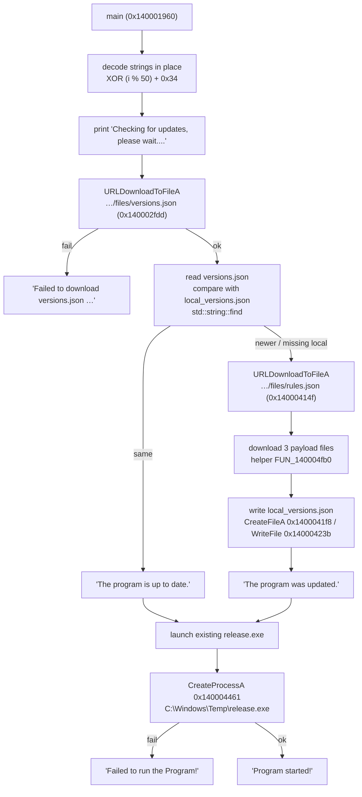

# DBDAxera: Unsigned Updater, Zero Integrity Checks


**TL;DR (EN).** `DBDAxera.exe` is a 1.66 MB, unsigned, `requireAdministrator`, console x64 binary with 8 imported functions — seven from `KERNEL32` and `URLDownloadToFileA` from `URLMON`. All meaningful strings are stored XOR-encoded with a repeating key `((i % 50) + 0x34)` and decoded in place at runtime. On start it downloads `versions.json` (and `rules.json`) from a Railway-hosted HTTP endpoint, compares the returned version string against a local cache using nothing more than `std::string::find`, then downloads `release.exe`, `libssl-3-x64.dll` and `libcrypto-3-x64.dll` into `C:\Windows\Temp\` and launches `release.exe` elevated. There is no hash check, no Authenticode validation, no TLS pinning and no persistence mechanism. The security problem is not the updater's complexity — it is that a single HTTPS host controls what runs as Administrator on every installed machine.


|  |  |
| --- | --- |
| **Filename** | `DBDAxera.exe` |
| **SHA-256** | `384843fc7cd08d6bfab36c3e3bde1aa33986ccfa940eadea3a59aef957c08546` |
| **Size** | 1,740,800 bytes (1.66 MB) |
| **Format** | PE32+ executable (console), x86-64 |
| **Compiled** | 2026-07-25 10:04:23 UTC (`TimeDateStamp 0x6A648A27`) |
| **Signed** | ❌ no Authenticode, no `VERSIONINFO`, no overlay |
| **Manifest** | `requestedExecutionLevel level="requireAdministrator"` |
| **Analysis** | 100% static — the sample was never executed |

---

## ทำไมตัวนี้ถึงน่าสนใจ

ถ้ามองผ่าน ๆ มันคือ loader ของ "โปรแกรมช่วยเล่นเกม" ตัวหนึ่ง — ชื่อไฟล์ เว็บที่มันต่อ และ DLL ที่มันโหลด (`libssl-3-x64.dll`, `libcrypto-3-x64.dll` ที่ดูเหมือน MSYS2/OpenSSL ที่ build มาเอง) ชี้ทางเดียวกันหมด

แต่คำถามที่ผมสนใจไม่ใช่ "มันเป็น cheat ไหม" คำถามคือ **ถ้าเราเป็นคนคุมเซิร์ฟเวอร์ปลายทาง เราสั่งให้เครื่องของผู้ใช้ทำอะไรได้บ้าง** — และคำตอบคือ "อะไรก็ได้ ที่รันด้วยสิทธิ์ Administrator"

ทั้งหมดนี้ไม่ได้มาจากช่องโหว่ zero-day แต่มาจากการออกแบบ: ไม่มีการตรวจอะไรเลยระหว่าง "ดาวน์โหลด" กับ "รัน"

## Static triage

### Import table — สั้นจนน่าตกใจ

```
KERNEL32.dll
  CreateFileA, WriteFile, CloseHandle, CreateProcessA,
  Sleep, GetLastError, ExitProcess
URLMON.DLL
  URLDownloadToFileA
```

แปดฟังก์ชัน ไม่มี `WinINet`, ไม่มี `advapi32`, ไม่มี `bcrypt`/`crypt32` และไม่มีอะไรที่เกี่ยวกับ registry หรือ service

การที่ import สั้นขนาดนี้มีผลกับการวิเคราะห์ตรง ๆ สองข้อ:

1. **งานทั้งหมดคือ "โหลด → เขียนไฟล์ → รัน"** ไม่มีโค้ดส่วนอื่นให้ตาม เพราะไม่มี API ให้เรียก
2. **ไม่มี persistence** — ถ้าจะรันตัวเองตอนบูต จะต้องใช้ registry run key / scheduled task / service ซึ่งทั้งหมดต้องผ่าน `advapi32` หรือ `taskschd` และไม่มีอยู่ในตาราง import เลย

### Section layout

`.rsrc` กินพื้นที่เกือบทั้งหมดของไฟล์ — **97%** — และข้างในมี resource เดียว: PNG ขนาด **1024×1024** ที่เป็นโลโก้ตัวอักษร "A" แบบเปลวไฟ เอาไว้โชว์ตอนเปิดโปรแกรม (ผมดึงออกมาแล้วใน [`assets/dbdaxera-logo.png`](../assets/dbdaxera-logo.png))

พูดอีกแบบ: โค้ดจริงมีไม่ถึง 3% ของไฟล์ ที่เหลือเป็นภาพสวย ๆ — และนั่นคือสัดส่วนที่บอกว่าผู้เขียนให้ความสำคัญกับอะไร

<figure><figcaption><p>โลโก้ที่ฝังอยู่ใน .rsrc — 1024×1024 PNG</p></figcaption></figure>

### Build artifacts ที่ผู้เขียนลืมลบ

```
C:\Repository\DBDAxera\build\release\DBDAxera.pdb
```

พาธ PDB ยังอยู่ครบ ลายเซ็นของ CMake + MSVC (มี `__isa_available` ค้างในไบนารี ซึ่งเป็น global ของ MSVC CRT) แปลว่าโปรเจกต์ build บนเครื่อง Windows ธรรมดา ไม่ได้ทำอะไรเพื่อซ่อนร่องรอยของการ build

## String obfuscation — XOR แบบง่าย ๆ ที่ยังใช้ได้ผล

ไม่มีสตริงที่อ่านออกสักตัวใน `.rdata` ที่น่าสนใจ ทุกอย่างถูกเก็บเป็นไบต์เข้ารหัส แล้วถอดในหน่วยความจำตอนเริ่มทำงาน

อัลกอริทึม (ยืนยันจากลูปที่ `0x1400026c0`):

```c
for (size_t i = 0; i < len; i++)
    buf[i] ^= (unsigned char)((i % 50) + 0x34);   // i % 0x32 + 0x34
```

คีย์ไม่ใช่ค่าคงที่ตัวเดียว แต่เป็นลำดับ 50 ไบต์ที่วนซ้ำ:

```
0x34 0x35 0x36 ... 0x64 0x65   (50..101)
```

ผลข้างเคียงที่น่าสนใจ: **สตริงที่ยาวกว่า 50 ไบต์ต้องถูกแบ่งเป็นสองท่อน** เพราะคีย์วนกลับไปเริ่มที่ `0x34` เมื่อ `i = 50` ถ้าคนเขียนลืมเรื่องนี้ ตัวอักษรตัวที่ 51 เป็นต้นไปจะถอดออกมาเพี้ยน — ซึ่งเราเห็นร่องรอยนี้จริงในข้อความ error ที่ยาวเกิน 50 ตัวอักษร (ถูกแบ่งเป็นสองสตริงแล้วต่อกัน)

จุดที่ต้องเข้าใจให้ถูก: **นี่คือการ obfuscation ไม่ใช่การเข้ารหัส** คีย์อยู่ในไบนารี มีลูปถอดรหัสอยู่ห่างจากข้อมูลไม่กี่ KB ใครเปิดไฟล์ดูก็ถอดได้ในสิบนาที (ผมใช้สคริปต์ 12 บรรทัด) สิ่งที่มันทำได้จริงคือหลบ `strings.exe` กับกฎ YARA แบบ plaintext — ซึ่งก็เพียงพอจะผ่านการสแกนครั้งแรก ๆ

### ตารางสตริงที่ถอดได้

| File offset | ที่เก็บแบบเข้ารหัส | ถอดออกมา |
| --- | --- | --- |
| `0x9280` | `0B 5E 53 4E 05 50 56 54 4A 58 50 56 27 26 23 43` | `?key=iloven****` (ดูหมายเหตุ) |
| `0x92A8` | `5C 41 42 47 4B 03 15 14 …4A 34` | `https://web-production-a1a4c.up.railway.app/files/` |
| `0x92E0` | `58 5C 54 44 4B 55 17 08 11 45 08 0B 6E 25 2E 2F 44` | `libssl-3-x64.dll` |
| `0x92F8` | `46 50 5A 52 59 4A 5F 15 59 45 5B 3F` | `release.exe` |
| `0x9328` | `58 5C 54 54 4A 40 4A 4F 53 10 0D 12 38 77 76 6D 20 29 2A 47` | `libcrypto-3-x64.dll` |


สตริง query parameter ตัวแรกมีคำเหยียดเชื้อชาติอยู่ในนั้น (ผู้เขียนเครื่องมือเป็นคนใส่ ไม่ใช่ผม) ผมปิดท้ายคำไว้ในบทความ แต่เก็บไบต์ดิบไว้ในกฎ YARA เพราะใช้เป็นลายนิ้วมือได้ ถ้าคุณเอากฎไปใช้แล้วไม่อยากมีข้อความนั้นในไฟล์ ให้ตัด pattern `$enc_query` ทิ้งได้เลย — กฎยังทำงานด้วย pattern อื่น


สตริงอื่นที่ถอดได้ (ข้อความบน console):

```
Checking for updates, please wait....
The program is up to date.
The program was updated.
Program started!
Failed to run the Program!
Failed to download versions.json -- cannot check for updates.
versions.json was empty or unreadable.
```

ชื่อไฟล์ที่มันจัดการ: `versions.json`, `rules.json`, `local_versions.json`, `release.exe`, `libssl-3-x64.dll`, `libcrypto-3-x64.dll` — ทำงานใน `C:\Windows\Temp\`

## Flow การทำงาน

`main` อยู่ที่ `FUN_140001960` ลำดับเหตุการณ์ที่ประกอบขึ้นจาก xref ของ API ทั้งแปดตัว:




แผนภาพนี้ประกอบจาก xref และลำดับการเรียก API ในไบนารี **ไม่ใช่จาก trace จริง** เพราะผมไม่ได้รันตัวอย่าง ลำดับที่แน่นอน (โดยเฉพาะสาขา "มีของใหม่อยู่แล้ว") ควรยืนยันด้วย debugger ก่อนอ้างอิงต่อ


ตัวช่วยที่ใช้ซ้ำสำหรับการดาวน์โหลดคือ `FUN_140004fb0` ซึ่งถูกเรียกสามครั้ง (จาก `0x1400035fd`, `0x140003616`, `0x14000362f`) — หนึ่งครั้งต่อไฟล์ payload มันประกอบ URL จาก base ที่ถอดไว้ + ชื่อไฟล์ แล้วเรียก `URLDownloadToFileA` ลง `C:\Windows\Temp\`

## "อัปเดต" ที่ไม่ตรวจอะไรเลย

นี่คือส่วนที่ผมคิดว่าเป็นปัญหาจริง ๆ ของตัวนี้ ไม่ใช่เรื่อง cheat

ขั้นตอนตรวจเวอร์ชันทำงานประมาณนี้:

1. โหลด `versions.json` จากเซิร์ฟเวอร์
2. อ่าน version string ที่ได้
3. เทียบกับ `local_versions.json` ที่เคยเขียนไว้ในเครื่อง
4. ถ้าต่าง → ดาวน์โหลดของใหม่ทับของเก่า

การเทียบในข้อ 3 ทำด้วย `std::string::find` ธรรมดา (substring match) ไม่ใช่การเทียบแฮช ไม่ใช่การเทียบลายเซ็น และไม่มีการตรวจความถูกต้องของ `versions.json` เองด้วย

สิ่งที่ **ไม่มี** ในห่วงโซ่นี้:

| สิ่งที่ควรมี | มีไหม |
| --- | --- |
| SHA-256 ของไฟล์ที่ดาวน์โหลด มาเทียบกับค่าที่เซิร์ฟเวอร์ส่งมา | ❌ ไม่มี |
| Authenticode / publisher pinning ของ `release.exe` | ❌ ไม่มี |
| TLS pinning หรือตรวจ certificate ของเซิร์ฟเวอร์ | ❌ ไม่มี (ใช้ `URLDownloadToFileA` ตามค่า default ของระบบ) |
| Rollback protection (กันการส่ง version เก่าที่มีช่องโหว่กลับมา) | ❌ ไม่มี |
| Signature ของ `versions.json` เอง | ❌ ไม่มี |

ผลที่ตามมาชัดเจน: **ใครก็ตามที่คุม `web-production-a1a4c.up.railway.app` ได้ สามารถส่งไบนารีอะไรก็ได้ให้ทุกเครื่องที่ลงโปรแกรมนี้ แล้วมันจะรันด้วยสิทธิ์ Administrator โดยที่ผู้ใช้ไม่เห็นอะไรนอกจากข้อความ "The program was updated."**

และเพราะตัวโปรแกรมขอ `requireAdministrator` เอง ผู้ใช้จึงถูกฝึกให้กด Yes ทุกครั้งที่เปิด — ซึ่งเป็นสภาพแวดล้อมที่แย่ที่สุดสำหรับ malware

การที่เซิร์ฟเวอร์อยู่บน Railway (โดเมนย่อยแบบ `web-production-xxxx.up.railway.app` ที่สร้างใหม่ได้ในไม่กี่นาที) ทำให้การ rotate / ย้าย / ทิ้ง infrastructure ทำได้ถูกและเร็ว ซึ่งเป็นเรื่องปกติของ loader สายนี้ และทำให้การบล็อกตามโดเมนได้ผลแค่ระยะสั้น

## Launcher semantics

จุดที่เรียก `CreateProcessA` อยู่ที่ `0x140004461` ผ่าน wrapper `FUN_140001560`:

- ชื่อโปรแกรม: `C:\Windows\Temp\release.exe` (path เต็ม ไม่ได้พึ่ง `PATH`)
- working directory: `C:\Windows\Temp\`
- ถ้า `CreateProcessA` คืนค่า fail → พิมพ์ `Failed to run the Program!` แล้วจบ

การเลือก `C:\Windows\Temp` มีเหตุผลในทางปฏิบัติสามข้อ: ทุกคนเขียนได้, ไม่ค่อยมีใครดู, และ AV หลายตัวไม่ไล่สแกนไฟล์ที่เพิ่งเขียนตรงนั้นแบบ real-time เท่าโฟลเดอร์ดาวน์โหลด แต่ก็แลกมาด้วยข้อเสียที่คนที่ทำ DFIR จะชอบมาก: **ไฟล์ยังอยู่หลังจากโปรเซสจบ** (`release.exe`, `rules.json`, `local_versions.json` ค้างใน `C:\Windows\Temp\`)

ส่วน `rules.json` ถูกดาวน์โหลดในเส้นทางการอัปเดต แต่ตัวบริโภคจริงไม่ได้อยู่ในไบนารีนี้ — น่าจะเป็น `release.exe` ที่อ่านต่อ (ผมไม่มีตัวอย่าง payload จึงยืนยันไม่ได้)

## สิ่งที่ไม่มีในตัวอย่างนี้

เพื่อไม่ให้เข้าใจผิดว่าตัวนี้ "ดุร้าย" กว่าที่เป็น:

- **ไม่มี persistence** — ไม่มี autorun, service, scheduled task, WMI subscription (ยืนยันจาก import table)
- **ไม่มี anti-analysis** — ไม่มี `IsDebuggerPresent`, ไม่มี timing check, ไม่มี VM detection, ไม่มี anti-sandbox
- **ไม่มี privilege escalation เอง** — ขอ Administrator ผ่าน manifest ตรง ๆ ไม่ได้ bypass อะไร
- **ไม่มี process injection / hollowing** — ไม่มี `VirtualAllocEx`/`WriteProcessMemory`/`CreateRemoteThread`
- **ไม่มี credential access** — ไม่มี `lsass`, ไม่มี `minidump`, ไม่มี DPAPI

ความเสี่ยงทั้งหมดของตัวนี้มาจาก **ช่องทางอัปเดต** ไม่ใช่จาก payload ในตัวมัน

## IOC

### Network

```
hxxps://web-production-a1a4c[.]up[.]railway[.]app/files/versions.json
hxxps://web-production-a1a4c[.]up[.]railway[.]app/files/rules.json
hxxps://web-production-a1a4c[.]up[.]railway[.]app/files/release.exe
hxxps://web-production-a1a4c[.]up[.]railway[.]app/files/libssl-3-x64.dll
hxxps://web-production-a1a4c[.]up[.]railway[.]app/files/libcrypto-3-x64.dll
```

query parameter: `?key=iloven****` (16 ไบต์, ดูหมายเหตุด้านบน)

### Host

```
C:\Windows\Temp\release.exe
C:\Windows\Temp\libssl-3-x64.dll
C:\Windows\Temp\libcrypto-3-x64.dll
C:\Windows\Temp\local_versions.json
C:\Windows\Temp\rules.json
```

### File

```
SHA-256  384843fc7cd08d6bfab36c3e3bde1aa33986ccfa940eadea3a59aef957c08546
PDB path C:\Repository\DBDAxera\build\release\DBDAxera.pdb
Imports  KERNEL32 (7) + URLMON.DLL!URLDownloadToFileA
```

## Detection

### YARA

กฎเต็มอยู่ใน [`detections/dbdaxera_updater.yar`](../detections/dbdaxera_updater.yar) — ใช้ **ไบต์ที่เข้ารหัสแล้ว** จากตัวอย่างจริง ไม่ใช่ plaintext ที่เดาเอา ซึ่งสำคัญเพราะ plaintext ไม่มีอยู่ในไฟล์เลย

```yara
rule MAL_Loader_DBDAxera_Updater
{
    meta:
        description = "DBDAxera updater/loader - XOR-obfuscated strings, URLMON downloader, elevated launcher"
        author      = "bpiecks"
        date        = "2026-11-13"
        sha256      = "384843fc7cd08d6bfab36c3e3bde1aa33986ccfa940eadea3a59aef957c08546"
        tlp         = "CLEAR"

    strings:
        // "https://web-production-a1a4c.up.railway.app/files/"  (XOR: key = (i % 50) + 0x34)
        $enc_url = { 5C 41 42 47 4B 03 15 14 4B 58 5C 12 30 33 2D 27 31 26 32 2E
                     27 27 67 2A 7D 2C 7A 2C 7E 24 22 7D 26 34 3F 3B 2F 38 23 75
                     3D 2D 2E 70 06 08 0E 06 17 4A 34 }
        // "release.exe"
        $enc_release   = { 46 50 5A 52 59 4A 5F 15 59 45 5B 3F }
        // "libssl-3-x64.dll"
        $enc_libssl    = { 58 5C 54 44 4B 55 17 08 11 45 08 0B 6E 25 2E 2F 44 }
        // "libcrypto-3-x64.dll"
        $enc_libcrypto = { 58 5C 54 54 4A 40 4A 4F 53 10 0D 12 38 77 76 6D 20 29 2A 47 }

    condition:
        uint16(0) == 0x5A4D and filesize < 20MB and
        $enc_url and 1 of ($enc_release, $enc_libssl, $enc_libcrypto)
}
```

ทำไม pattern พวกนี้ถึงใช้ได้: คีย์ XOR ขึ้นกับ **ตำแหน่งไบต์ในสตริง** จึงไม่มีทางที่ไฟล์อื่นจะบังเอิญมีลำดับไบต์เดียวกันตั้งแต่ต้นจนจบ (รวมไบต์ NUL ปิดท้ายที่เกิดจาก `0x34 ^ 0x34`) และเพราะ `$enc_url` เป็น URL ของผู้เขียนคนนี้โดยเฉพาะ กฎนี้จึงไม่ควร false positive กับ loader ตัวอื่น

### Hunting

ถ้า YARA ไม่ทัน (ของใหม่อัปเดตแล้วเปลี่ยนโดเมน) ให้ไล่จากพฤติกรรม ซึ่งเสถียรกว่ามาก:

| แหล่งข้อมูล | เงื่อนไขที่มอง |
| --- | --- |
| Sysmon EID 1 | `Image` = `C:\Windows\Temp\release.exe`, parent เป็นโปรเซสที่รันจากโฟลเดอร์ผู้ใช้ และ `IntegrityLevel` = High |
| Sysmon EID 11 | `versions.json` / `rules.json` / `local_versions.json` ถูกสร้างใน `C:\Windows\Temp\` |
| Sysmon EID 22 | DNS query ไป `*.up.railway.app` จากโปรเซสที่ไม่ได้เป็น browser |
| Proxy / firewall | `GET /files/versions.json` ที่มี query parameter สั้น ๆ ต่อท้าย |
| EDR | โปรเซสที่เขียนไฟล์ `.exe`/`.dll` ลง `C:\Windows\Temp\` แล้วรันไฟล์นั้นทันที |

เงื่อนไขสุดท้ายน่าจะมีค่าที่สุด เพราะมันอธิบายพฤติกรรมของ loader สายนี้ทั้งครอบครัว ไม่ใช่แค่ตัวนี้

## MITRE ATT&CK

| Technique | ID | หลักฐาน |
| --- | --- | --- |
| Obfuscated Files or Information | [T1027](https://attack.mitre.org/techniques/T1027/) | สตริงทั้งหมดเก็บแบบ XOR, ถอดในหน่วยความจำ |
| Ingress Tool Transfer | [T1105](https://attack.mitre.org/techniques/T1105/) | `URLDownloadToFileA` ดึง 5 ไฟล์จากปลายทางเดียว |
| Application Layer Protocol: Web Protocols | [T1071.001](https://attack.mitre.org/techniques/T1071.001/) | HTTP(S) ผ่าน `URLMON` ไปยังโดเมน Railway |
| User Execution: Malicious File | [T1204.002](https://attack.mitre.org/techniques/T1204.002/) | ผู้ใช้รัน loader เอง และกด UAC เพื่อให้ได้สิทธิ์ Administrator |
| Signed Binary Proxy Execution / Masquerading | T1036 | ชื่อและโลโก้เลียนแบบเครื่องมือเกม, DLL ชื่อเหมือน OpenSSL ของจริง |

**ไม่พบ:** T1547 (Boot or Logon Autostart), T1053 (Scheduled Task), T1055 (Process Injection), T1003 (Credential Access)

## ข้อจำกัดของการวิเคราะห์

ความซื่อสัตย์มาก่อนข้อสรุป:

1. **ไม่เคยรันตัวอย่างนี้** ทุกอย่างมาจาก static analysis การตีความลำดับเหตุการณ์จึงมาจาก xref และลำดับของ API call ไม่ใช่จาก trace จริง ถ้ามีเวลาและ lab ที่พร้อม การยืนยันด้วย Procmon + Wireshark จะปิดช่องว่างนี้ได้
2. **ไม่ได้วิเคราะห์ payload** (`release.exe`, DLL ทั้งสอง) จึงไม่รู้ว่า `rules.json` ถูกใช้ทำอะไร และ payload มีความสามารถอะไร
3. **การเทียบเวอร์ชัน** ตีความจาก import `std::string::find` และข้อความ console — ตรรกะที่แน่นอน ( substring ไหน เทียบกับอะไร ) ควรยืนยันด้วย debugger
4. **ลำดับการต่อ URL** (base + ไฟล์ + `?key=`) เป็นการอนุมานจากการที่สตริงถูกถอดในฟังก์ชันเดียวกันและจำนวนครั้งที่ helper ถูกเรียก — ไม่ได้เห็น request จริง
5. **ไม่รู้ที่มาของไฟล์** ว่าใครส่งให้ผู้ใช้ และแจกจ่ายผ่านช่องทางไหน

## สรุป

ไม่มีอะไรในตัว `DBDAxera.exe` ที่ซับซ้อน มันคือ 8 API calls กับสตริงที่ XOR ไว้ไม่กี่สิบไบต์

แต่ความเรียบง่ายนั่นเองที่ทำให้มันเป็นตัวอย่างที่ดี: **การอัปเดตอัตโนมัติที่ไม่มี integrity check คือการให้สิทธิ์ Administrator แก่เซิร์ฟเวอร์ของคนอื่น** ต่อให้วันนี้ payload ไม่มีอะไรน่ากลัว พรุ่งนี้มันอาจเป็นอะไรก็ได้ และผู้ใช้จะไม่รู้ตัวเลย เพราะสิ่งที่เห็นบนหน้าจอคือ "The program was updated."

ถ้าคุณจะเขียน updater ของตัวเอง (และคุณควรเขียน) สิ่งที่ต้องมีคือ: hash ของทุกไฟล์ที่เซิร์ฟเวอร์ส่งมา, ลายเซ็นของ metadata, และการปฏิเสธทุกอย่างที่ไม่ได้เซ็นด้วยคีย์ที่ฝังมากับไบนารี — ไม่ใช่ `std::string::find`

---

## Appendix A — Address map

| Address | สิ่งที่อยู่ตรงนั้น |
| --- | --- |
| `0x140001960` | `main` |
| `0x140001560` | wrapper ของ `CreateProcessA` (launcher) |
| `0x1400026c0` | ลูปถอดสตริง XOR (`i % 0x32` + `0x34`) |
| `0x140002fdd` | `URLDownloadToFileA` — `versions.json` |
| `0x1400035fd` | เรียก helper ดาวน์โหลด payload #1 |
| `0x140003616` | เรียก helper ดาวน์โหลด payload #2 |
| `0x14000362f` | เรียก helper ดาวน์โหลด payload #3 |
| `0x14000414f` | `URLDownloadToFileA` — `rules.json` |
| `0x1400041f8` | `CreateFileA` — เขียน `local_versions.json` |
| `0x14000423b` | `WriteFile` — เขียน `local_versions.json` |
| `0x140004461` | `CreateProcessA` — รัน `release.exe` |
| `0x140004fb0` | helper ประกอบ URL + ดาวน์โหลด |
| `0x14000d008` | `__isa_available` (MSVC CRT global) |

## Appendix B — Encoded bytes

ไบต์ดิบของสตริงที่ใช้เป็น pattern ในกฎ YARA (ที่ file offset ตามตารางด้านบน):

```
url        5C 41 42 47 4B 03 15 14 4B 58 5C 12 30 33 2D 27 31 26 32 2E
           27 27 67 2A 7D 2C 7A 2C 7E 24 22 7D 26 34 3F 3B 2F 38 23 75
           3D 2D 2E 70 06 08 0E 06 17 4A 34
query      0B 5E 53 4E 05 50 56 54 4A 58 50 56 27 26 23 43
libssl     58 5C 54 44 4B 55 17 08 11 45 08 0B 6E 25 2E 2F 44
release    46 50 5A 52 59 4A 5F 15 59 45 5B 3F
libcrypto  58 5C 54 54 4A 40 4A 4F 53 10 0D 12 38 77 76 6D 20 29 2A 47
```

สคริปต์ถอดรหัส (ใช้กับไฟล์ตัวอย่างของคุณเองได้):

```python
KEY = lambda i: (i % 50) + 0x34

def decode(buf: bytes) -> str:
    return bytes(b ^ KEY(i) for i, b in enumerate(buf)).rstrip(b"\x00").decode("latin-1")

data = open("DBDAxera.exe", "rb").read()
print(decode(data[0x92A8:0x92A8 + 51]))
# -> https://web-production-a1a4c.up.railway.app/files/
```
