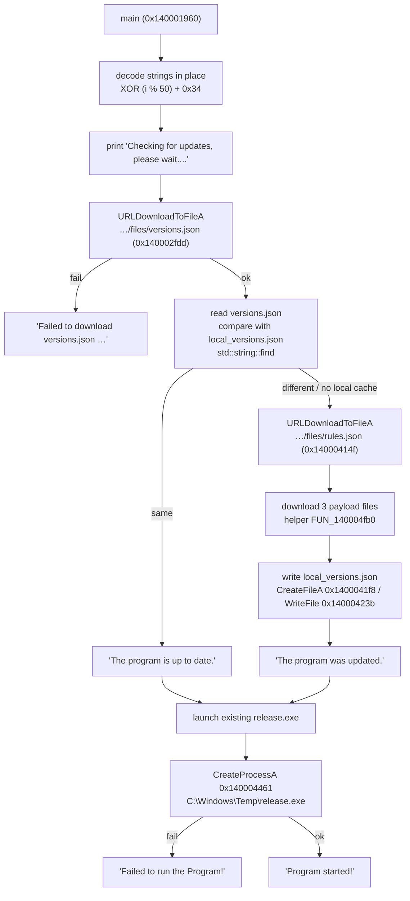

# Insecure Update Channel: Analyzing a DBDJpx Loader


**TL;DR:** A 1.66 MB unsigned x64 console binary that asks for Administrator in its manifest and imports eight functions, one of which is `URLDownloadToFileA`. Its strings are XOR-encoded with `((i % 50) + 0x34)` and decoded at startup. It pulls `versions.json` and `rules.json` from a Railway host, compares the version string with a local file using `std::string::find`, then downloads `release.exe` plus two OpenSSL DLLs into `C:\Windows\Temp\` and starts `release.exe`. No hash check, no signature check, no persistence. Whoever controls that host decides what runs as Administrator on every machine that installed this.


|  |  |
| --- | --- |
| **Filename** | `DBDJpx.exe` |
| **SHA-256** | `384843fc7cd08d6bfab36c3e3bde1aa33986ccfa940eadea3a59aef957c08546` |
| **Size** | 1,740,800 bytes (1.66 MB) |
| **Format** | PE32+ executable (console), x86-64 |
| **Compiled** | 2026-07-25 10:04:23 UTC (`TimeDateStamp 0x6A648A27`) |
| **Signed** | No Authenticode signature. No `VERSIONINFO`. No overlay. |
| **Manifest** | `requestedExecutionLevel level="requireAdministrator"` |
| **Analysis** | Static only. I never ran it. |

---

## Background

The name, the host it talks to and the two OpenSSL DLLs it fetches all fit the same story: this is the loader for a game cheat. Whether it cheats well is not something I can test, and not what I care about here.

What I wanted to know is what the update path allows. If I owned that server, what could I make this machine do? Turns out: anything, as Administrator. And nothing in the binary gets in the way.

## A quick look at the file

The import table is short enough to print in full:

```
KERNEL32.dll
  CreateFileA, WriteFile, CloseHandle, CreateProcessA,
  Sleep, GetLastError, ExitProcess
URLMON.DLL
  URLDownloadToFileA
```

Seven KERNEL32 functions and one from URLMON. No WinINet, no advapi32, no crypt32. Nothing that opens the registry, nothing that talks to services.

Two things follow from that list. First, the program does one job: download, write file, launch. Second, there is no persistence, because persistence needs an API this binary does not import. I can stop looking, which saves time.

The resources section is where it gets odd. `.rsrc` is 97% of the file and contains one thing: a 1024×1024 PNG of a flame-shaped "A", shown when the program starts. I pulled it out, it's in [`assets/dbdjpx-logo.png`](../assets/dbdjpx-logo.png).

<figure><figcaption><p>The only resource in the file: a 1024×1024 PNG.</p></figcaption></figure>

So the code is under 3% of the binary and the rest is a picture. Fine, it's a cheat loader, nobody is optimising for file size.

The author also left the PDB path in:

```
C:\Repository\DBDAxera\build\release\DBDAxera.pdb
```

Plus a leftover `__isa_available` global, which is MSVC runtime. Built with CMake on a normal Windows box, no attempt to clean up after the build.

## The strings

Nothing useful is readable in `.rdata`. Strings are stored as bytes and decoded in place at startup, one byte at a time:

```c
for (size_t i = 0; i < len; i++)
    buf[i] ^= (unsigned char)((i % 50) + 0x34);
```

I confirmed that loop at `0x1400026c0`. The key isn't a single byte, it's 50 bytes that repeat: `0x34, 0x35, 0x36 … 0x64, 0x65`.

One detail worth knowing if you write this kind of thing: because the key length is 50, any string longer than 50 bytes has to be split into two chunks, or everything from byte 51 onwards decodes to junk. The author hit this. One of the console messages is over 50 characters and is stored as two separate strings that get joined.

It's obfuscation, not encryption. The key sits in the same binary, the loop is a few KB from the data, and my decoder is twelve lines. What it does defeat is `strings` and plaintext YARA rules, which is what most first-pass scanning relies on.

Here's what came out:

| File offset | Stored bytes | Decoded |
| --- | --- | --- |
| `0x9280` | `0B 5E 53 4E 05 50 56 54 4A 58 50 56 27 26 23 43` | `?key=iloven****` (see note) |
| `0x92A8` | `5C 41 42 47 4B 03 15 14 …4A 34` | `https://web-production-a1a4c.up.railway.app/files/` |
| `0x92E0` | `58 5C 54 44 4B 55 17 08 11 45 08 0B 6E 25 2E 2F 44` | `libssl-3-x64.dll` |
| `0x92F8` | `46 50 5A 52 59 4A 5F 15 59 45 5B 3F` | `release.exe` |
| `0x9328` | `58 5C 54 54 4A 40 4A 4F 53 10 0D 12 38 77 76 6D 20 29 2A 47` | `libcrypto-3-x64.dll` |


The first row is a query parameter that contains a racial slur. The tool's author put it there, not me. I masked the end of it in this post because it doesn't add anything, but I left the raw bytes in the YARA rule since the 16-byte sequence is a decent fingerprint. If you'd rather not have that token in your ruleset, delete `$enc_query` from the rule. It still works.


The console messages also decoded. These are the only strings a user ever sees:

```
Checking for updates, please wait....
The program is up to date.
The program was updated.
Program started!
Failed to run the Program!
Failed to download versions.json -- cannot check for updates.
versions.json was empty or unreadable.
```

## What it does when it runs

`main` is at `FUN_140001960`. The order below comes from the xrefs on those eight imports, not from watching it run.




I did not run the sample, so this diagram is inferred. The branch where the tool is already up to date is the one I'm least sure about; it should be checked with a debugger before anyone cites it.


Downloads go through one helper, `FUN_140004fb0`, called three times (`0x1400035fd`, `0x140003616`, `0x14000362f`), once per payload file. It builds the URL from the decoded base plus the filename and calls `URLDownloadToFileA` into `C:\Windows\Temp\`.

## The update check

This is the part I'd actually report, not the cheating.

The flow is: fetch `versions.json`, read the version string, compare it against `local_versions.json` from the previous run, and if they differ, download the new files over the old ones.

The comparison is `std::string::find`. A substring match. Not a hash, not a signature, and `versions.json` is never checked either.

So here's everything that isn't there:

| Check | Present |
| --- | --- |
| SHA-256 of the downloaded file against a server-provided value | No |
| Authenticode or publisher pinning on `release.exe` | No |
| Its own TLS pinning or certificate checks | No, it uses `URLDownloadToFileA` defaults |
| Rollback protection | No |
| Signature over `versions.json` | No |

Which means anyone who can deploy to `web-production-a1a4c.up.railway.app` can ship a binary to every installed copy, and it will run as Administrator. The user sees "The program was updated." and nothing else.

The manifest makes that worse. The program demands elevation on every launch, so the user has been trained to click Yes without reading. That's the ideal environment for this.

And Railway is a subdomain you can create in a few minutes and drop just as fast, so blocking the domain buys weeks at most.

## How it starts the payload

`CreateProcessA` is at `0x140004461`, wrapped by `FUN_140001560`.

- Executable: `C:\Windows\Temp\release.exe`, full path
- Working directory: `C:\Windows\Temp\`
- On failure it prints `Failed to run the Program!` and exits

`C:\Windows\Temp` is the obvious choice here. Everyone can write to it, it's not a folder people browse, and some AV engines are slower to look at it than at Downloads. It also leaves the files behind after the process exits: `release.exe`, `rules.json` and `local_versions.json` are still sitting there when you arrive with a forensic image.

`rules.json` is downloaded along the update path but nothing in this binary reads it. Presumably `release.exe` does. I don't have the payload, so I can't say what's in there.

## What it doesn't do

Worth stating, because a loader with a remote update channel gets assumed to be worse than it is:

- No persistence of any kind. No run key, no service, no scheduled task, no WMI subscription. The import table rules most of it out.
- No anti-analysis. No `IsDebuggerPresent`, no timing checks, no VM detection.
- No elevation trick. It asks for Administrator in the manifest and that's it.
- No injection. No `VirtualAllocEx`, no `WriteProcessMemory`, no `CreateRemoteThread`.
- No credential access. Nothing touches `lsass` or DPAPI.

The risk is all in the update channel.

## IOCs

Network:

```
hxxps://web-production-a1a4c[.]up[.]railway[.]app/files/versions.json
hxxps://web-production-a1a4c[.]up[.]railway[.]app/files/rules.json
hxxps://web-production-a1a4c[.]up[.]railway[.]app/files/release.exe
hxxps://web-production-a1a4c[.]up[.]railway[.]app/files/libssl-3-x64.dll
hxxps://web-production-a1a4c[.]up[.]railway[.]app/files/libcrypto-3-x64.dll
```

Query parameter: `?key=iloven****`

Files written:

```
C:\Windows\Temp\release.exe
C:\Windows\Temp\libssl-3-x64.dll
C:\Windows\Temp\libcrypto-3-x64.dll
C:\Windows\Temp\local_versions.json
C:\Windows\Temp\rules.json
```

Sample:

```
SHA-256  384843fc7cd08d6bfab36c3e3bde1aa33986ccfa940eadea3a59aef957c08546
PDB      C:\Repository\DBDAxera\build\release\DBDAxera.pdb
Imports  KERNEL32 (7) + URLMON.DLL!URLDownloadToFileA
```

## Detection

The rule is in [`detections/dbdjpx_updater.yar`](../detections/dbdjpx_updater.yar). It matches the encoded bytes from the sample, since the plaintext isn't in the file to match against.

```yara
rule MAL_Loader_DBDJpx_Updater
{
    meta:
        description = "DBDJpx updater/loader - XOR-obfuscated strings, URLMON downloader, elevated launcher"
        author      = "bpiecks"
        date        = "2026-11-13"
        sha256      = "384843fc7cd08d6bfab36c3e3bde1aa33986ccfa940eadea3a59aef957c08546"
        tlp         = "CLEAR"

    strings:
        // "https://web-production-a1a4c.up.railway.app/files/"  (XOR: key = (i % 50) + 0x34)
        $enc_url = { 5C 41 42 47 4B 03 15 14 4B 58 5C 12 30 33 2D 27 31 26 32 2E
                     27 27 67 2A 7D 2C 7A 2C 7E 24 22 7D 26 34 3F 3B 2F 38 23 75
                     3D 2D 2E 70 06 08 0E 06 17 4A 34 }
        // "release.exe"
        $enc_release   = { 46 50 5A 52 59 4A 5F 15 59 45 5B 3F }
        // "libssl-3-x64.dll"
        $enc_libssl    = { 58 5C 54 44 4B 55 17 08 11 45 08 0B 6E 25 2E 2F 44 }
        // "libcrypto-3-x64.dll"
        $enc_libcrypto = { 58 5C 54 54 4A 40 4A 4F 53 10 0D 12 38 77 76 6D 20 29 2A 47 }

    condition:
        uint16(0) == 0x5A4D and filesize < 20MB and
        $enc_url and 1 of ($enc_release, $enc_libssl, $enc_libcrypto)
}
```

The key depends on the byte's position in the string, so a coincidental match elsewhere would have to reproduce the whole sequence including the trailing NUL that falls out of `0x34 ^ 0x34`. And `$enc_url` is this author's host. It shouldn't fire on anything else.

YARA will miss the next build, though, because the domain is the first thing to change. Hunt the behaviour instead:

| Source | What to look for |
| --- | --- |
| Sysmon 1 | `C:\Windows\Temp\release.exe` running, parent from a user profile, integrity level High |
| Sysmon 11 | `versions.json`, `rules.json` or `local_versions.json` created in `C:\Windows\Temp\` |
| Sysmon 22 | DNS query to `*.up.railway.app` from something that isn't a browser |
| Proxy | `GET /files/versions.json` with a short query string |
| EDR | A process that writes an `.exe` or `.dll` into `C:\Windows\Temp\` and executes it seconds later |

The last row is the one I'd actually deploy. It describes the family rather than this build.

## ATT&CK

| Technique | ID | Evidence |
| --- | --- | --- |
| Obfuscated Files or Information | [T1027](https://attack.mitre.org/techniques/T1027/) | Strings stored XOR-encoded, decoded in memory |
| Ingress Tool Transfer | [T1105](https://attack.mitre.org/techniques/T1105/) | Five files from one endpoint |
| Application Layer Protocol: Web Protocols | [T1071.001](https://attack.mitre.org/techniques/T1071.001/) | HTTP(S) through URLMON |
| User Execution: Malicious File | [T1204.002](https://attack.mitre.org/techniques/T1204.002/) | User runs the loader and approves the UAC prompt |
| Masquerading | [T1036](https://attack.mitre.org/techniques/T1036/) | Name, logo and OpenSSL DLL names taken from real software |

Not seen: T1547, T1053, T1055, T1003.

## What I couldn't verify

1. I never ran it. The sequence above comes from xrefs and API ordering. A Procmon and Wireshark session in a proper lab would settle it.
2. I don't have the payload. `release.exe` and the two DLLs are what actually matter, and what `rules.json` is for is a guess.
3. The version comparison is inferred from the `std::string::find` import and the console messages. Which substring gets compared against what needs a debugger.
4. The URL assembly order (base + filename + query) is inferred from the strings being decoded in one function and the helper being called three times. I never saw a request.
5. I don't know where the file came from or how it was distributed.

## Final notes

Eight API calls and a few dozen encoded bytes. That's the whole program.

Which is why I wrote it up. An updater that validates nothing is a standing grant of Administrator to whoever holds the server. Today the payload might be a cheat; tomorrow it's something else, and the only thing the user sees is "The program was updated."

If you're building an updater: sign the metadata, publish a hash for every file, and refuse anything not signed with a key that ships inside your binary. `std::string::find` is not a security control.

---

## Appendix A: addresses

| Address | What's there |
| --- | --- |
| `0x140001960` | `main` |
| `0x140001560` | wrapper around `CreateProcessA` |
| `0x1400026c0` | XOR decode loop (`i % 0x32` + `0x34`) |
| `0x140002fdd` | `URLDownloadToFileA`, `versions.json` |
| `0x1400035fd` | download helper call, payload 1 |
| `0x140003616` | download helper call, payload 2 |
| `0x14000362f` | download helper call, payload 3 |
| `0x14000414f` | `URLDownloadToFileA`, `rules.json` |
| `0x1400041f8` | `CreateFileA`, writing `local_versions.json` |
| `0x14000423b` | `WriteFile`, writing `local_versions.json` |
| `0x140004461` | `CreateProcessA`, starting `release.exe` |
| `0x140004fb0` | URL build + download helper |
| `0x14000d008` | `__isa_available` (MSVC CRT) |

## Appendix B: encoded bytes

```
url        5C 41 42 47 4B 03 15 14 4B 58 5C 12 30 33 2D 27 31 26 32 2E
           27 27 67 2A 7D 2C 7A 2C 7E 24 22 7D 26 34 3F 3B 2F 38 23 75
           3D 2D 2E 70 06 08 0E 06 17 4A 34
query      0B 5E 53 4E 05 50 56 54 4A 58 50 56 27 26 23 43
libssl     58 5C 54 44 4B 55 17 08 11 45 08 0B 6E 25 2E 2F 44
release    46 50 5A 52 59 4A 5F 15 59 45 5B 3F
libcrypto  58 5C 54 54 4A 40 4A 4F 53 10 0D 12 38 77 76 6D 20 29 2A 47
```

To decode a string yourself:

```python
KEY = lambda i: (i % 50) + 0x34

def decode(buf: bytes) -> str:
    return bytes(b ^ KEY(i) for i, b in enumerate(buf)).rstrip(b"\x00").decode("latin-1")

data = open("DBDJpx.exe", "rb").read()
print(decode(data[0x92A8:0x92A8 + 51]))
# -> https://web-production-a1a4c.up.railway.app/files/
```
