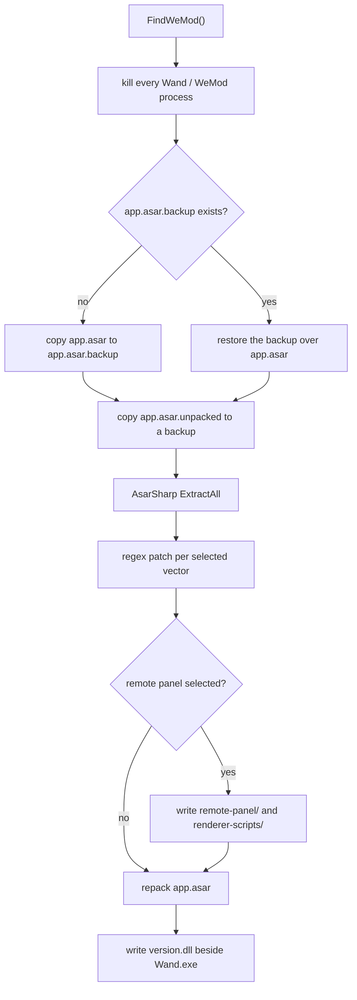

# WandEnhancer: Patching Another App's Fuses


**TL;DR:** `WandEnhancer.exe` is a 1.12 MB unsigned .NET GUI that finds WeMod (or its newer name, Wand) under `%LOCALAPPDATA%`, kills it, unpacks `resources\app.asar`, and rewrites the minified Electron JavaScript with regexes until the account object says the subscription is active. Then it repacks the archive and drops an unsigned `version.dll` next to `Wand.exe`. That DLL forwards 17 VERSION exports to the real system DLL, then scans the running Wand process for Electron's 32-byte fuse sentinel and writes a single byte into the fuse wire, switching `embeddedAsarIntegrityValidation` from `1` to `r`. The file on disk is never touched. One optional patch vector also starts an HTTP and WebSocket server on `0.0.0.0:3223` with no authentication at all.


|  |  |
| --- | --- |
| **Filename** | `WandEnhancer.exe` |
| **SHA-256** | `f3bbbf159bc0118d61c590b0ec381acc126fcde6c87f3f624748133120423974` |
| **Size** | 1,177,088 bytes |
| **Format** | PE32+ (.NET Framework 4.0 assembly), x64, WPF |
| **Compiled** | `TimeDateStamp 0x664B906C` (2024-05-20 18:03:24 UTC, but see below) |
| **Signed** | No Authenticode, no strong name |
| **Manifest** | `requestedExecutionLevel level="asInvoker"` |
| **Version** | `1.0.8.4` (`ProductName` WandEnhancer) |
| **Analysis** | Static only. I never ran it. |

The binary it drops:

|  |  |
| --- | --- |
| **Embedded as** | resource `proxydll`, copied to the .NET file at offset `0x5E569` |
| **Dropped as** | `version.dll` in the Wand/WeMod `app-<version>` directory |
| **SHA-256** | `b06cb1563cf60fe36f77673da794e3b61d09a1c30c368d079cc4afb89441d1ac` |
| **Size** | 14,336 bytes |
| **Format** | PE32+ DLL, x86-64, six sections |
| **Compiled** | 2026-06-10 14:00:49 UTC (`TimeDateStamp 0x6A296E11`) |
| **Signed** | No Authenticode |
| **Exports** | 17 functions with VERSION.dll names |

The sample arrived as a folder called `WeMod - Pro [B Version]` with that one executable inside. I hashed it again right before publishing and it still matches the SHA-256 above, so the analysis and the table are talking about the same bytes. The file itself is not in this repository.

---

## Why this one is interesting

This is not malware. It is a game-cheat patcher, published on GitHub, with a GUI and twelve languages, and its whole purpose is to switch on a paid subscription without paying.

I wrote it up anyway because the technique stack is what you normally find in an implant: a side-loaded DLL with a system-DLL name, a runtime patch to a hardened binary, a hidden PowerShell self-update, and a network service with no authentication. Nothing about those four things is specific to cheating. The label on the box is the only part that differs.

There is also a piece of it I could verify properly rather than infer: the fuse patch is one byte, and I could read the same byte in the vendor's binary to confirm which fuse it lands on.

## Static triage

### It is a merged .NET assembly

Two sections, no import directory, a CLR header at RVA `0x2000`, runtime `v4.0.30319`. Nothing is packed and no obfuscator touched it, so `ilspycmd` gave back readable C# with original class and method names.

The manifest resource list shows it was merged with ILRepack: the binary contains `AsarSharp` (an asar archive reader/writer), `Newtonsoft.Json` 13.0.0, and the `WandEnhancer` assembly itself. A leftover text resource spells it out:

```
AsarSharp, Version=1.0.0.0, Culture=neutral, PublicKeyToken=null
Newtonsoft.Json, Version=13.0.0.0, ...
WandEnhancer, Version=1.0.8.4, Culture=neutral, PublicKeyToken=null
```

The debug directory still points at the build machine:

```
D:\a\Wand-Enhancer\Wand-Enhancer\WandEnhancer\bin\Release\ILRepack-7968-364211\WandEnhancer.pdb
```

`D:\a\` is the path a GitHub Actions Windows runner uses, so this came off CI, not a developer's desktop. The `ILRepack-7968-364211` suffix is the temp folder ILRepack picked for that run.

The timestamp in the header says 2024-05-20, which is two years before the DLL inside it was compiled. It is not a build date. The .NET SDK produces deterministic builds by default and puts a content-derived value in `TimeDateStamp`, so the field is only meaningful as an identity check. The DLL, built with a normal C++ toolchain, has a real date.

### Looking for the target

`Extensions.FindWeMod()` checks two places in order:

```
%LOCALAPPDATA%\Wand
%LOCALAPPDATA%\WeMod
```

Under each it enumerates directories matching `^app-\w+`, sorts them by `LastWriteTime` descending, and takes the first one that contains both `<Brand>.exe` and `resources\app.asar`. If that fails it enumerates running processes named `Wand` and `WeMod` and reads `MainModule.FileName` from each.

Two brand names, because the app was renamed. Old installs keep the `WeMod` folder.

### What one click does



Two details in there matter.

First, the tool refuses to patch twice: if `app.asar.backup` already exists, it tells you to restore first. The restore path is just as simple, and it deletes `version.dll` from the app directory on the way out.

Second, `AttachProxyDll()` runs at the end of `Patch()` unconditionally. Even if you tick nothing but "Disable updates", you still get the DLL. That is not a user-visible choice.

## The patch vectors

Four vectors exist in `EnhancerConfig.GetInstance()`, and each one is a regex over WeMod's minified JavaScript:

| Vector | Where it matches | What the replacement does |
| --- | --- | --- |
| `ActivatePro` | `getUserAccount()`, `setAccountWandBrandExperience()`, `setAccountLanguage()` | Appends `response.subscription={period:"yearly",state:"active"}` to the account response |
| `DisableUpdates` | `registerHandler("ACTION_CHECK_FOR_UPDATE", ...)` in `index.js` | Swaps the update feed handler for `expectUpdateFeedUrl(e,(e=>null))` |
| `DevToolsOnF12` | `app.whenReady().then(` in `index.js` | Injects a `browser-window-created` hook that opens DevTools when F12 is pressed |
| `RemoteWebPanelPreview` | Five functions around `client-state`, plus `whenReady().then(run)` | Boots `remote-panel/bridge.cjs` and mirrors trainer state to it |

The pro patch is my favourite line in the whole program, because of how little it does:

```js
getUserAccount(){return this.#<service>.fetch({endpoint:"/v3/account",method:"GET",
name:"/v3/account",collectMetrics:0}).then(response=>{
response.subscription={period:"yearly",state:"active"};return response;})}
```

No license check is defeated, no token is forged. The client asks its own backend who you are, and the patch makes the local copy of the answer say "yearly, active". Whether the rest of the app honours that object is a question for whoever runs it.

The regexes are written against a specific bundle shape. They use `.*?` across newlines and `[\w$]+` for minified identifiers, and if a pattern stops matching the tool throws `The version may not be supported`. `SingleMatch` is set by default, so a second match aborts the patch instead of rewriting the wrong function. That is more care than the updater in [my previous post](2026-11-13-dbdaxera-updater.md) takes.

There is also a fifth enum member with no implementation:

```csharp
public enum EPatchType
{
    ActivatePro = 1,
    DisableUpdates = 2,
    DisableTelemetry = 4,
    DevToolsOnF12 = 8,
    RemoteWebPanelPreview = 0x10
}
```

`DisableTelemetry` has no entry in the patch dictionary, so selecting it would end with `Failed to apply patches: DisableTelemetry` and a rolled-back archive. The dialog never offers it. It is a leftover from a feature that did not ship, and it is the kind of thing you find in every tool of this size.

## The proxy DLL

`version.dll` is loaded by almost every Windows GUI process, and Windows looks in the application directory before `system32`. Putting a file with that name next to `Wand.exe` means the app loads it instead of the real one, so any code in it runs inside the Electron main process before `app.asar` is read. That is DLL side-loading, and it is deliberate: the DLL's export name is `VERSION.dll` and it exports all 17 functions.

### DllMain

```
0x180001000  DllMain
  DisableThreadLibraryCalls(hinst)
  GetSystemDirectoryW(buf, 260)         -> C:\Windows\System32
  wcscat_s(buf, 260, L"\\version.dll")
  LoadLibraryW(buf)                     -> the real VERSION.dll
  GetProcAddress x16                    -> stored in a table at 0x180005088
  call 0x180001590                      -> the payload
```

Every exported stub (`0x180001270` through `0x180001560`) is a jump through that table, so the target application keeps working normally while the payload runs.

Only two functions are imported: `SetLastError` and the CRT. Everything else is resolved at runtime, which keeps the import table looking like a template-generated proxy.

### The payload

`0x180001650` walks the host process image from `GetModuleHandleA(NULL)`, 8 bytes at a time, comparing four 64-bit immediates:

```
48 B9 64 4C 37 70 4B 47 64 6E      mov rcx, "dL7pKGdn"
49 B8 4E 7A 37 39 36 50 62 62      mov r8,  "Nz796Pbb"
49 B9 6A 51 57 4E 4B 6D 48 58      mov r9,  "jQWNKmHX"
49 BA 42 5A 61 42 39 74 73 58      mov r10, "BZaB9tsX"
```

Those four strings are 32 bytes of ASCII, but the compiler stored them as immediate operands, so the marker does not exist as a contiguous string anywhere in the file. Scanning for the ASCII text finds nothing. You need the byte pattern.

Together they spell the Electron fuse sentinel:

```
dL7pKGdnNz796PbbjQWNKmHXBZaB9tsX
```

### What the fuse wire is

Electron ships with package-time switches ("fuses") that the app author flips before signing. They live in the binary as a small structure:

```
sentinel (32 bytes) | version (1 byte) | fuse count (1 byte) | N state bytes
```

Each state byte is `0x30` ("0", disabled) or `0x31` ("1", enabled). Electron's documentation also defines `0x72` ("r") for a removed fuse.

I read the wire out of the Wand build I had here (`app-12.40.0\Wand.exe`, file offset `0xB11C090`):

```
dL7pKGdnNz796PbbjQWNKmHXBZaB9tsX  01  09  30 30 30 30 31 31 30 31 31
                    sentinel      v1   9   |  |  |  |  |  |  |  |  |
                                          0  0  0  0  1  1  0  1  1
```

Mapped against the fuse order in Electron's docs:

| # | Fuse | Value |
| --- | --- | --- |
| 0 | `runAsNode` | 0 |
| 1 | `cookieEncryption` | 0 |
| 2 | `nodeOptions` | 0 |
| 3 | `nodeCliInspect` | 0 |
| 4 | `embeddedAsarIntegrityValidation` | **1** |
| 5 | `onlyLoadAppFromAsar` | 1 |
| 6 | `loadBrowserProcessSpecificV8Snapshot` | 0 |
| 7 | `grantFileProtocolExtraPrivileges` | 1 |
| 8 | `wasmTrapHandlers` | 1 |

The vendor did the reasonable thing: asar integrity validation on, only load from asar, Node and `NODE_OPTIONS` and `--inspect` off. That combination stops you from editing `app.asar` on disk, which is exactly what WandEnhancer wants to do.

### The one byte write

`0x180001590` takes the marker address and does this:

```c
if (*(uint8_t *)(marker + 33) > 4)            // fuse count, must be > 4
{
    void *p = (void *)(marker + 38);          // states[4] = embeddedAsarIntegrityValidation
    if (*(char *)p != 'r')
    {
        VirtualProtect(p, 1, PAGE_READWRITE, &old);
        *(char *)p = 'r';
        VirtualProtect(p, 1, old, &old);
    }
}
```

Offset 33 is the fuse count (`9` in the table above), so the check is "does this build have at least five fuses" and it protects against writing past the end of the wire. Offset 38 is index 4. Writing `'r'` marks the fuse as removed rather than as disabled, and per Electron's docs a removed fuse can no longer be flipped back to `0` or `1`.

So the vendor's integrity check is switched off inside the process, after the signature check has already passed, in a page that is not the file.

Two consequences worth pointing out:

- **The file on disk still has `1`.** If you scan `Wand.exe` you will see an intact, validly signed Electron binary. The evidence only exists in memory, and only while the process is running.
- **It is not specific to Wand.** Any Electron app that enables that fuse can be patched the same way, with the same four immediates and the same one-byte write. The only thing tying this DLL to WeMod is where the patcher copies it.

The DLL does nothing else. No network, no other process, no persistence. It exists to make a modified archive load.

## The remote panel

The vector labelled `Enable remote access (beta)` in the dialog is the one I would raise with the author.

The bridge it installs (`remote-panel\bridge.cjs`, bundled from `web-panel/`) starts a server inside the Electron main process:

```js
DEFAULT_REMOTE_HOST: "0.0.0.0",
DEFAULT_REMOTE_PORT: 3223,
PORT_SCAN_RANGE: 30,
REMOTE_BASE_PATH: "/remote/",
REMOTE_WS_PATH: "/remote/ws",
REMOTE_HEALTH_PATH: "/remote/api/health",
REMOTE_INSTALLED_APPS_API_PATH: "/remote/api/installed-apps"
```

`0.0.0.0` means every interface, not just loopback. If port 3223 is taken it walks upward for 30 ports.

The HTTP side redirects `/` to `/remote/`, serves the panel bundle from `/remote/`, and exposes two JSON endpoints without any check:

```
GET /remote/api/health           state, trainer id, session state, URL list
GET /remote/api/installed-apps   every installed game: platform, SKU, game id,
                                 title id, install path, image URL, playtime
```

The WebSocket side has no session, no token, and no `Origin` check. A client sends `{"type":"hello"}` and gets `hello_ack` with `accepted:true`, then the current trainer snapshot. After that it can send:

- `remote_command` with `action: "launch"` or `"stop"` and a game id, which reaches into the renderer and starts or stops a trainer
- `set_value` with a `target` and `value`, which writes a cheat value through `setValue(..., Remote)`

Everything the panel can do, anyone who can reach the port can do, while the user has Wand open. That includes toggling cheats in games and reading a list of installed titles with filesystem paths. On a shared or untrusted network that is a problem, and the assets it serves are the same page an attacker would see, so there is no "only my machine" assumption anywhere in the code.

The log tells you whether it has run:

```
%TEMP%\wand-remote-bridge.log
```

with lines like `[wand-remote-bridge] [info] Listening on http://192.168.x.x:3223/remote/`.

To be fair to the author: this is labelled beta, it is off unless you tick the box, and it exists so a phone on the same network can drive the panel. But it is an unauthenticated control channel exposed on all interfaces, and it ships in a binary that most users will run once and forget.

## The updater

`Updater.cs` asks GitHub for the latest release, compares the tag against the assembly version, and takes the first asset whose name ends with `.exe`:

```
https://api.github.com/repos/k1tbyte/Wand-Enhancer/releases/latest
```

Then it writes the download to `%TEMP%` and runs:

```powershell
Start-Sleep -Seconds 2
Copy-Item -Path '<download>' -Destination '<its own exe>' -Force
Remove-Item -Path '<download>' -Force
Start-Sleep -Seconds 1
Start-Process -FilePath '<its own exe>'
```

through `powershell.exe -WindowStyle Hidden -ExecutionPolicy Bypass -Command "..."`, and shuts itself down 500 ms later.

No hash check on the asset. No Authenticode validation. No pinning of the download URL beyond "whatever GitHub returns for this repo". The same weakness as the loader in my [first post](2026-11-13-dbdaxera-updater.md), in a tool with a fraction of the sophistication: whoever gets write access to that repository, or to the GitHub account behind it, replaces the binary on every installed machine. The user sees a hidden PowerShell window for a second and nothing else.

That is a normal pattern for small open-source tools, and it is the reason I keep writing about it. A hidden PowerShell process that overwrites a running executable is on every EDR watchlist, and it is there because the practice is indistinguishable from the way malware updates itself.

## What it does not do

To keep this in proportion:

- **No elevation.** The manifest asks for `asInvoker`, and nothing in the code tries to get higher.
- **No persistence.** `version.dll` only loads while Wand runs. There is no run key, no service, no scheduled task, no WMI subscription anywhere in the decompiled code.
- **No injection into other processes.** No `WriteProcessMemory`, no `CreateRemoteThread`, no `VirtualAllocEx`. The DLL ends up inside Wand because Windows loads it there, not because anything injected it.
- **No credential access.** Nothing touches `lsass`, DPAPI, or the browser stores.
- **No exfiltration.** The only outbound traffic is the GitHub API.
- **No obfuscation.** Readable IL, real class names, a PDB path still in the debug directory. ILRepack merged the dependencies; that is packaging, not protection.

The risk here is the design, not a hidden payload. The tool does what it says it does.

## IOC

Network:

```
hxxps://api.github.com/repos/k1tbyte/Wand-Enhancer/releases/latest
hxxps://api.github.com/repos/k1tbyte/Wand-Enhancer/releases?per_page=20
hxxps://github.com/k1tbyte/Wand-Enhancer
```

Listener, only when the remote panel vector is chosen:

```
0.0.0.0:3223  (walks up to 3253 if busy)
```

Host:

```
%LOCALAPPDATA%\Wand\app-<version>\version.dll
%LOCALAPPDATA%\Wand\app-<version>\resources\app.asar.backup
%LOCALAPPDATA%\Wand\app-<version>\resources\app.asar.unpacked.backup
%LOCALAPPDATA%\Wand\app-<version>\resources\app.asar.unpacked\remote-panel\bridge.cjs
%LOCALAPPDATA%\Wand\app-<version>\resources\app.asar.unpacked\remote-panel\renderer-scripts\*.js
%TEMP%\wand-remote-bridge.log
%TEMP%\<release-asset>.exe      (transient, self-update)
```

`%LOCALAPPDATA%\WeMod\...` for installs that predate the rename.

File:

```
SHA-256  f3bbbf159bc0118d61c590b0ec381acc126fcde6c87f3f624748133120423974  WandEnhancer.exe
SHA-256  b06cb1563cf60fe36f77673da794e3b61d09a1c30c368d079cc4afb89441d1ac  version.dll
PDB      D:\a\Wand-Enhancer\Wand-Enhancer\WandEnhancer\bin\Release\ILRepack-7968-364211\WandEnhancer.pdb
```

## Detection

Rules are in [`detections/wandenhancer_patcher.yar`](../detections/wandenhancer_patcher.yar). Two of them, because the front end and the DLL have nothing in common.

```yara
rule MAL_Tool_WandEnhancer_VersionProxy
{
    meta:
        description = "Unsigned VERSION.dll proxy that patches Electron's fuse wire in memory (embeddedAsarIntegrityValidation)"
        author      = "bpiecks"
        date        = "2026-11-13"
        sha256      = "b06cb1563cf60fe36f77673da794e3b61d09a1c30c368d079cc4afb89441d1ac"

    strings:
        $fuse_sentinel = {
            48 B9 64 4C 37 70 4B 47 64 6E
            49 B8 4E 7A 37 39 36 50 62 62
            49 B9 6A 51 57 4E 4B 6D 48 58
            49 BA 42 5A 61 42 39 74 73 58
        }
        $dll_name    = "VERSION.dll" ascii
        $ver_install = "VerInstallFileW" ascii
        $ver_query   = "VerQueryValueW" ascii
        $sysdir      = "GetSystemDirectoryW" ascii

    condition:
        uint16(0) == 0x5A4D and filesize < 2MB and
        pe.number_of_exports > 10 and
        $fuse_sentinel and 2 of ($dll_name, $ver_install, $ver_query, $sysdir)
}
```

The sentinel pattern alone would match any Electron binary, because they all contain that string. Requiring the immediates layout (four `mov` opcodes with the string split across them), a DLL with more than ten exports, and the VERSION export names in the same file is what makes it a proxy DLL rather than Electron itself.

I checked every pattern in both rules against the two files by direct byte search, including the UTF-16 forms in the .NET string heap. All of them are present at the offsets in the appendix.

Hunting, when the hash changes and the rules miss:

| Source | What to look for |
| --- | --- |
| Sysmon 11 | `version.dll` created inside `%LOCALAPPDATA%\Wand\app-*\` or `%LOCALAPPDATA%\WeMod\app-*\` |
| Sysmon 11 | `app.asar.backup` or `app.asar.unpacked.backup` created under a user profile |
| Sysmon 1 | `powershell.exe` with `-WindowStyle Hidden -ExecutionPolicy Bypass` and a `Copy-Item` whose destination is a running `.exe` |
| Sysmon 3 / 22 | a non-browser process reaching `api.github.com` on startup |
| Sysmon 1 | an unsigned .NET binary killing every `Wand.exe` process |
| Netstat / EDR | `Wand.exe` or `WeMod.exe` listening on `0.0.0.0:3223` |

The fourth row is the one I would deploy and forget, because hidden PowerShell that overwrites an executable is rare in legitimate software even when the software is legitimate.

## MITRE ATT&CK

Mapping a modding tool to ATT&CK is imprecise, since none of these techniques are used against anyone who did not install the tool. Read it as "these are the behaviours an analyst would tag", not as an attribution.

| Technique | ID | Evidence |
| --- | --- | --- |
| DLL Side-Loading | [T1574.002](https://attack.mitre.org/techniques/T1574/002/) | Unsigned `version.dll` placed beside `Wand.exe` |
| Subvert Trust Controls | [T1553](https://attack.mitre.org/techniques/T1553/) | Asar integrity fuse set to `r` in memory after the signature check |
| Masquerading | [T1036](https://attack.mitre.org/techniques/T1036/) | A system DLL name, exported VERSION functions, WeMod branding |
| Ingress Tool Transfer | [T1105](https://attack.mitre.org/techniques/T1105/) | Release asset downloaded from the GitHub API |
| Command and Scripting Interpreter: PowerShell | [T1059.001](https://attack.mitre.org/techniques/T1059/001/) | Hidden window, `-ExecutionPolicy Bypass`, replaces the running exe |
| User Execution: Malicious File | [T1204.002](https://attack.mitre.org/techniques/T1204/002/) | The user runs the patcher and picks the vectors |

**Not observed:** T1547 (autostart), T1053 (scheduled task), T1055 (injection), T1003 (credential access), T1071 (application-layer C2).

## Limitations

1. **I never ran it.** Everything about runtime order comes from the decompiled code and the test machine's installed copy, not from a trace. The patched archive loading successfully is inferred from the fuse patch, not observed.
2. **The fuse mapping is from Electron's documentation plus the byte layout.** I read the wire out of the installed `Wand.exe` and matched indices to the documented fuse order. I did not watch Electron react to the `r` byte.
3. **One build only** (`1.0.8.4`). The patch regexes are tied to a minified bundle shape and will fail on a different WeMod version, probably with the tool's own "not supported" message.
4. **Wand.exe itself is 223 MB** and I only read its fuse wire. Anything the app does with the patched subscription object is outside this post.
5. **The remote panel was read, not exercised.** What an unauthenticated client can do is derived from the message handlers in `bridge.cjs`. I did not open the port and send frames.
6. **No attribution.** The handle `k1tbyte` comes from the binary's own constants and the public repository. Who runs that account is not something static analysis will tell you.

## Closing

The interesting part of this tool is not the cheating. It is that the cheapest way to modify a hardened Electron app was to side-load a system DLL and flip four bytes of fuse wire in memory, and that this works on any Electron app with the same fuse enabled.

The rest is ordinary: a regex over minified JavaScript, a zip archive repacked, a GitHub updater with no integrity check, a debug port left open on every interface.

If you build or use a tool like this, three things are worth copying from the good side of it and three from the bad. Good: it backs up before it patches, it refuses a second patch, and it aborts when a regex matches more than once. Bad: the updater trusts whatever GitHub returns, the DLL is dropped even when the user did not ask for it, and the remote panel has no authentication.

---

## Appendix A: proxy DLL address map

Image base `0x180000000`.

| Address | What's there |
| --- | --- |
| `0x180001000` | `DllMain`: loads `system32\version.dll`, resolves 16 exports into a table, calls the payload |
| `0x180001270` | `GetFileVersionInfoA` stub (first of 17 export forwards) |
| `0x180001590` | fuse patch: `VirtualProtect` on `marker + 38`, writes `'r'` |
| `0x180001650` | scans the host image for the 32-byte sentinel, 8 bytes at a time |
| file `0xAB5` / VA `0x1800016B5` | the four `mov` immediates holding the sentinel |
| `0x180005080` | `HMODULE` of the real `VERSION.dll` |
| `0x180005088` | start of the 16-entry forwarded function table |

## Appendix B: reading a fuse wire

Works on any Electron binary, read-only:

```python
import sys

SENTINEL = b"dL7pKGdnNz796PbbjQWNKmHXBZaB9tsX"
NAMES = ["runAsNode", "cookieEncryption", "nodeOptions", "nodeCliInspect",
         "embeddedAsarIntegrityValidation", "onlyLoadAppFromAsar",
         "loadBrowserProcessSpecificV8Snapshot", "grantFileProtocolExtraPrivileges",
         "wasmTrapHandlers"]

data = open(sys.argv[1], "rb").read()
i = data.find(SENTINEL)
if i < 0:
    raise SystemExit("no fuse wire in this file")

version, count = data[i + 32], data[i + 33]
states = data[i + 34:i + 34 + count].decode("latin-1")
print(f"offset 0x{i:X}  version {version}  fuses {count}  states {states}")

for n, state in zip(NAMES, states):
    label = {"0": "disabled", "1": "enabled", "r": "removed"}.get(state, f"unknown 0x{ord(state):02x}")
    print(f"  {n:<40} {label}")
```

Run against `Wand.exe` from `app-12.40.0`, it prints `states 000011011` and reports `embeddedAsarIntegrityValidation enabled`. Run it against the same process after WandEnhancer has patched it and that line would read `removed`, except the patch never touches the file, so there is nothing on disk to read.
