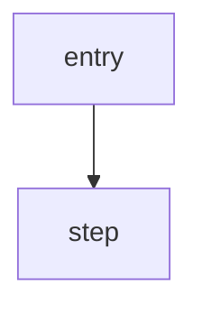

# Sample Name: What It Actually Does


**TL;DR.** Two to four sentences: what the file is, how it is obfuscated, what it does at runtime, and the single most important security finding. No code, no hedging — just the conclusion.


|  |  |
| --- | --- |
| **Filename** | `sample.exe` |
| **SHA-256** | `…` |
| **Size** | … bytes |
| **Format** | PE32+/PE32, x64/x86, console/GUI |
| **Compiled** | YYYY-MM-DD HH:MM:SS UTC (`TimeDateStamp 0x…`) |
| **Signed** | ✅ by `…` / ❌ unsigned |
| **Analysis** | 100% static / sandbox / dynamic |

---

## Why this one is interesting

One paragraph: the thing that makes it worth writing about — unusual behaviour, a new technique, or a design flaw.

## Static triage

### Import table

```text
KERNEL32.dll
  …
```

What this import list implies, and what is notably *absent* (e.g. no `advapi32` → no persistence).

### Sections / resources

Table or list, plus observations (entropy, overlay, odd resources).

### Build artifacts

PDB path, compiler hints, timestamps the author forgot to strip.

## Main content

*(pick the headings that fit the case — obfuscation scheme, C2 protocol, persistence, injection, …)*

### Obfuscation

Explain the algorithm, then show something runnable:

```c
for (size_t i = 0; i < len; i++)
    buf[i] ^= (unsigned char)((i % 50) + 0x34);
```

| File offset | Encoded bytes | Decoded |
| --- | --- | --- |
| `0x…` | `…` | `…` |

### Execution flow



## IOC

### Network

```
hxxps://host[.]tld/path
```

### Host

```
C:\path\to\artifact
```

### File

```
SHA-256  …
```

## Detection

### YARA

```yara
rule …
```

### Hunting

| Source | Condition to look for |
| --- | --- |
| Sysmon EID 1 | … |

## MITRE ATT&CK

| Technique | ID | Evidence |
| --- | --- | --- |
| … | [T…](https://attack.mitre.org/techniques/T…/) | … |

**Not observed:** …

## Limitations

1. …
2. …

## Closing

One paragraph: the lesson that transfers to other cases, not a restatement of the summary.

---

## Appendix A — Address map

| Address | What lives there |
| --- | --- |
| `0x…` | … |

## Appendix B — Scripts

```python
# reproducible decoding / extraction
```
