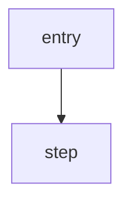

# Sample Name: What It Actually Does


**TL;DR (EN).** Two to four sentences: what the file is, how it is obfuscated, what it does at runtime, and the single most important security finding. No code, no hedging — just the conclusion.


|  |  |
| --- | --- |
| **Filename** | `sample.exe` |
| **SHA-256** | `…` |
| **Size** | … bytes |
| **Format** | PE32+/PE32, x64/x86, console/GUI |
| **Compiled** | YYYY-MM-DD HH:MM:SS UTC (`TimeDateStamp 0x…`) |
| **Signed** | ✅ by `…` / ❌ unsigned |
| **Analysis** | 100% static / sandbox / dynamic |

---

## ทำไมตัวนี้ถึงน่าสนใจ

ย่อหน้าเดียว: จุดที่ทำให้ตัวนี้ควรค่าแก่การเขียน — พฤติกรรมแปลก, เทคนิคใหม่, หรือช่องโหว่เชิงออกแบบ

## Static triage

### Import table

```text
KERNEL32.dll
  …
```

อธิบายว่า import สั้น/ยาวแบบนี้บอกอะไร และอะไรที่ *ไม่มี* (เช่น ไม่มี `advapi32` → ไม่มี persistence)

### Sections / resources

ตารางหรือรายการ พร้อมข้อสังเกต (entropy, overlay, resource แปลก ๆ)

### Build artifacts

PDB path, compiler hints, timestamps ที่ผู้เขียนลืมลบ

## เนื้อหาหลัก

*(เลือกหัวข้อที่ตรงกับเคส — obfuscation scheme, C2 protocol, persistence, injection, …)*

### Obfuscation

อธิบายอัลกอริทึม + snippet ที่รันได้จริง:

```c
for (size_t i = 0; i < len; i++)
    buf[i] ^= (unsigned char)((i % 50) + 0x34);
```

| File offset | Encoded bytes | Decoded |
| --- | --- | --- |
| `0x…` | `…` | `…` |

### Execution flow



## IOC

### Network

```
hxxps://host[.]tld/path
```

### Host

```
C:\path\to\artifact
```

### File

```
SHA-256  …
```

## Detection

### YARA

```yara
rule …
```

### Hunting

| แหล่งข้อมูล | เงื่อนไขที่มอง |
| --- | --- |
| Sysmon EID 1 | … |

## MITRE ATT&CK

| Technique | ID | หลักฐาน |
| --- | --- | --- |
| … | [T…](https://attack.mitre.org/techniques/T…/) | … |

**ไม่พบ:** …

## ข้อจำกัด

1. …
2. …

## สรุป

ย่อหน้าปิด: บทเรียนที่เอาไปใช้กับเคสอื่นได้ ไม่ใช่สรุปซ้ำ

---

## Appendix A — Address map

| Address | สิ่งที่อยู่ตรงนั้น |
| --- | --- |
| `0x…` | … |

## Appendix B — Scripts

```python
# reproducible decoding / extraction
```
